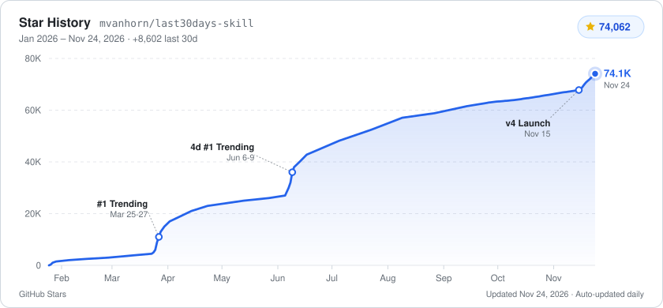

# /last30days

[English](README.md) | [Français](README.fr.md) | [Deutsch](README.de.md) | [Español](README.es.md) | [Português (Brasil)](README.pt-BR.md) | [日本語](README.ja.md) | [简体中文](README.zh-CN.md) | [العربية](README.ar.md) | فارسی | [Türkçe](README.tr.md)

<p align="center">
  
</p>

<p align="center">
  <a href="https://github.com/mvanhorn/last30days-skill">
    
  </a>
  <br/>
  <a href="https://trendshift.io/repositories/21997" target="_blank">
    
  </a>
  <br/>
  <a href="https://github.com/mvanhorn/last30days-skill/actions/workflows/validate.yml">
    
  </a>
</p>

**یک موتور جستجو با هدایت ایجنت هوش مصنوعی، رتبه‌بندی‌شده بر اساس رأی‌های مثبت (Upvotes)، لایک‌ها و پول واقعی — نه نظر ویراستاران.**

این README روند کاری نسخه ۴ (v4) فعلی را دنبال می‌کند. مشخصات اجرایی اسکیل در [skills/last30days/SKILL.md](skills/last30days/SKILL.md) قرار دارد که مرجع اصلی آخرین رفتار دستورات و راه‌اندازی است.

**Claude Code (توصیه‌شده — به‌روزرسانی خودکار از طریق بازارچه):**
```
/plugin marketplace add mvanhorn/last30days-skill
/plugin install last30days
```

**Codex، Cursor، Copilot، Gemini CLI یا بیش از ۵۰ میزبان [Agent Skills](https://agentskills.io):**
```
npx skills add mvanhorn/last30days-skill -g
```
(`-g` اسکیل را به صورت سراسری برای کاربر شما نصب می‌کند تا در تمام پروژه‌ها در دسترس باشد. برای محدود کردن آن به یک پروژه، این پرچم را حذف کنید.)

گزینه‌های نصب بیشتر (نسخه وب claude.ai، OpenClaw، دستی) در بخش [نصب](#نصب) در ادامه آمده است.

بدون نیاز به پیکربندی. ردیت، HN، Polymarket و گیت‌هاب بلافاصله کار می‌کنند، و همچنین ثبت اختراعات و صفحات فرصت‌های شغلی زمانی که موضوع شما یک شرکت باشد. آن را یک بار اجرا کنید تا ویزارد راه‌اندازی در ۳۰ ثانیه قفل دسترسی به X، YouTube، TikTok، arXiv، Techmeme و موارد دیگر را باز کند.

---

رأی‌های مثبت ردیت. لایک‌های X. رونوشت‌های یوتیوب. تعاملات تیک‌تاک. شانس‌های Polymarket که با پول واقعی و اطلاعات دست اول پشتیبانی می‌شوند. این میلیون‌ها نفری هستند که هر روز با توجه و کیف پول خود رأی می‌دهند. اسکیل /last30days همه این‌ها را به صورت موازی جستجو می‌کند، آن‌ها را بر اساس آنچه مردم واقعی واقعاً با آن تعامل داشته‌اند امتیازدهی می‌کند، و یک داور از جنس ایجنت هوش مصنوعی آن را در یک گزارش خلاصه سنتز می‌کند.

گوگل ویراستاران را تجمیع می‌کند. /last30days مردم را جستجو می‌کند.

شما نمی‌توانید این جستجو را در هیچ جای دیگری دریافت کنید زیرا هیچ هوش مصنوعی تکی به همه آن‌ها دسترسی ندارد. جستجوی گوگل به کامنت‌های ردیت یا پست‌های X دسترسی ندارد. چت‌جی‌پی‌تی با ردیت قرارداد دارد اما نمی‌تواند X یا تیک‌تاک را جستجو کند. جمینای یوتیوب را دارد اما ردیت را ندارد. کلود هیچ‌کدام را به صورت بومی ندارد. هر پلتفرم یک باغ محصور با API، توکن‌ها و احراز هویت خاص خود است. اما شما می‌توانید کلیدها و نشست‌های مرورگر خود را بیاورید و ناگهان یک ایجنت هوش مصنوعی می‌تواند همه آن‌ها را هم‌زمان جستجو کند، آن‌ها را در برابر یکدیگر امتیازدهی کند و به شما بگوید چه چیزی واقعاً مهم است.

رمز گشایش در همین است. نه یک موتور جستجوی بهتر، بلکه یک جین پلتفرم جدا از هم که توسط یک ایجنت پل ارتباطی بین آن‌ها برقرار شده است.

```
/last30days Peter Steinberger
```

شما فردا یک جلسه دارید. نام طرف را گوگل می‌کنید. لینکدین او از سال ۲۰۲۳ را می‌بینید. اما /last30days به شما می‌دهد که او در این ماه واقعاً چه کار می‌کند: برای کار روی Codex به OpenAI پیوسته، با ممنوعیت ایجنت‌های شخص ثالث توسط Anthropic مبارزه می‌کند، ۲۳ پول‌ریکوئست (PR) را با نرخ مرج ۸۵٪ شیپ کرده، در حال ساخت "LobsterOS" برای کنترل ایجنت چنددستگاهی است، و جامعه r/ClaudeCode با ۵۶۹ رأی مثبت بحث می‌کند که آیا او یک قهرمان است یا "غیرقابل تحمل". پراکنده در پست‌های X، تاپیک‌های ردیت، رونوشت‌های یوتیوب و کامیت‌های گیت‌هاب. هیچ‌کدام در گوگل نبودند.

## چرا این ابزار وجود دارد

من آن را برای عقب نماندن در دنیای هوش مصنوعی ساختم. همه چیز هر روز تغییر می‌کند و افراد پیگیر در ردیت و X همیشه اولین کسانی هستند که متوجه ماجرا می‌شوند. من به پرامپت‌های بهتری نیاز داشتم و داده‌های آموزشی همیشه ماه‌ها از آنچه جامعه کاربری قبلاً کشف کرده بود عقب‌تر بودند.

اما به چیزی بسیار بزرگ‌تر تبدیل شد. حالا قبل از یک تماس فروش آن را اجرا می‌کنم تا حقیقت ۳۰ روز گذشته یک کسب‌وکار را بدانم. قبل از جلسه برای خواندن توییت‌های اخیر و رونوشت‌های پادکست یک شخص. قبل از سفر به Disney World تا بدانم کدام وسایل بازی تعطیل هستند و جامعه کاربری درباره Genie+ چه می‌گوید. قبل از اینکه هر چیزی بسازم تا بدانم مردم واقعاً با چه مشکلاتی مواجه هستند.

اگر با یک مدیرعامل ملاقات دارید، آیا همه توییت‌ها و رونوشت‌های یوتیوب ۳۰ روز گذشته او را خوانده‌اید؟ من خوانده‌ام.

## منابع، با امتیازدهی مردم

| منبع | آنچه مردم به شما می‌گویند |
|------|---------------------------|
| **Reddit** | دیدگاه‌های بدون فیلتر. کامنت‌های برتر با تعداد رأی‌های مثبت واقعی، رایگان، بدون کلید API. نظرات واقعی که گوگل پنهان می‌کند. با تأیید شما، می‌تواند با حساب کاربری ردیت شما جستجو کند تا تاپیک‌های بیشتر و امتیازهای زنده دریافت کند. |
| **X / Twitter** | دیدگاه‌های داغ، رشته‌توییت‌های تخصصی، واکنش‌های فوری به اخبار. اولین جایی که باخبر می‌شوند، اولین جایی که بحث می‌کنند. |
| **YouTube** | بررسی عمیق ۴۵ دقیقه‌ای. جستجو در رونوشت‌های کامل ویدیوها برای یافتن ۵ جمله کلیدی و قابل نقل‌قول که اهمیت دارند. |
| **TikTok** | تولیدکننده‌ای که به ۳.۶ میلیون نفر دسترسی دارد با دیدگاهی که هرگز در گوگل پیدا نخواهید کرد. |
| **Instagram Reels** | دیدگاه اینفلوئنسرها با رونوشت کلمات صحبت‌شده. سیگنال فرهنگ بصری. |
| **Hacker News** | اجماع جامعه توسعه‌دهندگان. ۸۲۵ امتیاز، ۸۹۹ کامنت. جایی که افراد فنی واقعاً در آن بحث می‌کنند. |
| **Polymarket** | نه نظرات شخصی، بلکه احتمالات بازار. پشتیبانی‌شده با پول واقعی. اطمینان ۹۶٪ درباره فروش آلبوم. ۴٪ درباره یک فرایند تصاحب. این گزارش، احتمالات یک بازار را در یک خط زیر داستانی که به آن مربوط است همراه با میزان جابه‌جایی آن نمایش می‌دهد. |
| **GitHub** | برای افراد: سرعت ارسال PR، مخازن برتر بر اساس ستاره، گزارش تغییرات نسخه‌ها. برای موضوعات: ایشوها و بحث‌ها. |
| **Digg** | خوشه‌های خبری از تمام موضوعات Digg (هوش مصنوعی، فناوری، جهان و کسب‌وکار، ورزش، علم، بازی، سرگرمی)، رتبه‌بندی‌شده بر اساس امتیاز Digg، همراه با نقل‌قول‌های درون‌خطی از X (بدون نیاز به احراز هویت X). در صورت قرار داشتن `digg-pp-cli` در PATH به صورت خودکار فعال می‌شود. نسخه قدیمی `digg-pp-cli` همچنان کار می‌کند، فقط برای هوش مصنوعی و فناوری و بدون امتیاز. |
| **arXiv** | مقالات علمی در پس سر و صداهای رسانه‌ای. تحقیقات جدید در بازه زمانی، رایگان، بدون کلید API. در صورت قرار داشتن `arxiv-pp-cli` در PATH به صورت خودکار فعال می‌شود (نصب توسط راه‌اندازی اولیه). |
| **Techmeme** | لایه تحریریه اخبار فناوری، محدود به بازه زمانی ۳۰ روزه شما. رایگان، بدون کلید API. در صورت قرار داشتن `techmeme-pp-cli` در PATH به صورت خودکار فعال می‌شود (نصب توسط راه‌اندازی اولیه). |
| **Yahoo Finance** | برداشت بازار از یک شرکت. جابه‌جایی قیمت سهام در طول ۳۰ روز شما، در کنار شاخص S&P 500 برای شرکت‌های پذیرفته‌شده در بورس آمریکا. رایگان، بدون کلید API. زمانی که موضوع شما یک شرکت سهامی عام یا فرد هدایت‌کننده آن باشد و `yahoo-finance-pp-cli` در PATH قرار داشته باشد نمایش داده می‌شود (نصب توسط راه‌اندازی اولیه). |
| **LinkedIn** | سیگنال حرفه‌ای و تجاری. پست‌ها و مقالات، که مقالات وزن سیگنال بالاتری دریافت می‌کنند. |
| **Meta Ads** | آنچه یک برند برای گفتنش پول می‌دهد. طرح‌های تبلیغاتی فعال در متای راه‌اندازی‌شده در این ماه، همراه با متن، کدهای تخفیف و رونوشت‌های صوتی. |
| **StockTwits** | احساسات معامله‌گران. زمانی که موضوع شما یک نماد بورسی یا رمزارز باشد به طور خودکار فعال می‌شود. |
| **Threads** | لایه متنی پس از توییتر. گفتگوهای میان تولیدکنندگان محتوا و برندها. |
| **Pinterest** | کشف بصری. پین‌ها، ذخیره‌ها و نظرات درباره محصولات و ایده‌ها. |
| **Xiaohongshu (RED)** | سیگنال‌های سبک زندگی، محصول و تولیدکنندگان محتوای چینی. به طور صریح با `--search xhs` فراخوانی می‌شود در صورتی که پلاگین مرورگر ورود به سیستم x-mcp یا سرویس `xiaohongshu-mcp` به صورت محلی در حال اجرا باشد. |
| **Bluesky** | لایه اجتماعی غیرمتمرکز. پست‌های پروتکل AT حاصل از مهاجرت پس از توییتر. |
| **Perplexity** | سنتز کنترل‌شده Agent API، جایگزین OpenRouter Sonar، ردیف‌های خام Search API و جستجوی عمیق صریح Deep Research. |
| **DEV Community (dev.to)** | مقالات توسعه‌دهندگان و نظرات برتر از طریق API عمومی و بدون کلید. فعال‌سازی اختیاری با `--devto-tags`، `--search devto` یا `INCLUDE_SOURCES=devto`. |
| **Truth Social** | جستجوی پست‌ها با `TRUTHSOCIAL_TOKEN`؛ در صورت احراز هویت در دسترس است. |
| **Telegram** | پست‌های عمومی از کانال‌های نام‌برده‌شده. نیازمند فعال‌سازی دستی؛ نیازمند `SCRAPECREATORS_API_KEY` و یک لیست کانال است. بدون کشف از طریق کلمات کلیدی. |
| **Trustpilot** | امتیاز TrustScore شرکت، تعداد نظرات و خلاصه هوش مصنوعی از بازخورد مشتریان. نیازمند فعال‌سازی؛ نیازمند قرار داشتن `trustpilot-pp-cli` در PATH و یک نشست معتبر است. |
| **Amazon** | رتبه‌بندی محصولات، قیمت‌ها و نظرات خریداران. نیازمند فعال‌سازی؛ نیازمند CLI احراز هویت شده `brightdata` است و از اعتبارات Bright Data شما استفاده می‌کند. |
| **DripStack** | خبرنامه‌های مالی و تحلیل‌های تحلیلی از طریق یک API عمومی و بدون کلید. فعال‌سازی اختیاری با `--search dripstack` یا `INCLUDE_SOURCES=dripstack`. |
| **Jobs / careers pages** | آنچه یک شرکت برای آن در حال استخدام است، خوانده‌شده از صفحه مشاغل خود شرکت (Workday، Apple، Amazon، Google، Microsoft، Netflix، Oracle و غیره). اجرای یک بررسی شرکتی به طور خودکار آن را می‌خواند، و نقش‌هایی که به موضوعی معرفی‌نشده اشاره دارند به سیگنال‌های محرمانه صفحه استخدام (Jobs Page Secret Signals) تبدیل می‌شوند. همچنین با `--hiring-signals`، `--search jobs` یا پلن پژوهشی قابل انتخاب است. |
| **Patents** | درخواست‌های ثبت اختراع جدید آمریکا برای یک شرکت، به عنوان مدرکی از آنچه قبل از عرضه در حال ساخت آن است. رایگان، بدون کلید API. زمانی که موضوع شما یک شرکت باشد نمایش داده می‌شود. یک درخواست ثبت اختراع تنها زمانی به سیگنال محرمانه پتنت تبدیل می‌شود که برای شرکت غیرمعمول باشد یا چیزی را توصیف کند که هنوز عرضه یا اعلام نشده است. |
| **Local corpus** | فایل‌های محلی Markdown و متنی شما، به همراه فایل‌های PDF در صورتی که `pdftotext` در PATH موجود باشد. فعال‌سازی اختیاری با `--corpus` یا `LAST30DAYS_CORPUS_DIRS`. |
| **Web** | پوشش‌های تحریریه، مقایسه‌های وبلاگی. یک سیگنال در کنار سایر سیگنال‌ها، نه تنها سیگنال موجود. |

از `/last30days` بخواهید منابعی را که نیاز دارید لحاظ کند. در دسترس بودن بستگی به اعتبارسنجی‌ها، ابزارهای نصب‌شده، موضوع و انتخاب‌های صریح دارد. بخش [الزامات منابع](CONFIGURATION.md#source-requirements) را برای پیکربندی مشاهده کنید.

یک رشته ردیت با ۱,۵۰۰ رأی مثبت سیگنالی قوی‌تر از یک پست وبلاگی است که هیچ‌کس نخوانده است. یک ویدیو تیک‌تاک با ۳.۶ میلیون بازدید بیش از یک بیانیه مطبوعاتی به شما درباره آنچه از نظر فرهنگی مرتبط است اطلاعات می‌دهد. شانس‌های Polymarket که با ۶۶ هزار دلار حجم مالی پشتیبانی می‌شوند، سخت‌تر از حدس و گمان یک کارشناس قابل رد هستند.

این سنتز بر اساس آنچه مردم واقعی واقعاً با آن تعامل داشته‌اند رتبه‌بندی می‌کند. ارتباط اجتماعی، نه ارتباط سئو (SEO).

## کاربردهای واقعی کاربران

**قبل از یک جلسه.** `/last30days Peter Steinberger` - پیوستن به تیم Codex در OpenAI، مبارزه با ممنوعیت ایجنت‌های شخص ثالث در Anthropic، مرج شدن ۲۳ پی‌آر با نرخ موفقیت ۸۵٪ در گیت‌هاب، توسعه LobsterOS برای کنترل ایجنت چنددستگاهی. جامعه r/ClaudeCode: "از زمان انتشار OpenClaw، همه می‌دانستند که اگر آن را از طریق هر چیزی غیر از API اجرا کنید، در نهایت مسدود خواهید شد" (۲۲۷ رأی مثبت). این مورد در لینکدین نیست.

**برای دیدن آنچه یک شرکت قبل از رونمایی در حال ساخت آن است.** `/last30days Apple` - سیگنال محرمانه صفحه استخدام به یک موقعیت شغلی مدیر جدید اشاره کرد که وظیفه آزمایش اجرای تراکنش‌ها از طریق APIهای شریک و سیستم‌های مالی را بر عهده دارد؛ چیزی که شبیه کنترل کیفیت برای دستیاری است که خریدها را کامل می‌کند. سیگنال محرمانه پتنت به یک درخواست ثبت اختراع برای تغییر وضعیت یک دستگاه با تپ کردن روی آن در یک عکس ذخیره‌شده از اتاقتان اشاره کرد. پلتفرم Polymarket شانس ۹۱٪ به اپل برای بزرگ‌ترین شرکت جهان در پایان سال داد. دستور `/last30days Alphabet` یک موقعیت مدیر محصول برای "YouTube Ads Agentic Buyflows" پیدا کرد، و خط سهام آن افت ۱۷.۶٪ را طی ۳۰ روز در حالی که S&P 500 افت ۳.۶٪ داشت نشان داد، با بدترین روز در ۲۹ اکتبر (-۱۲.۶٪). برای یک گزارش صرفاً استخدامی، پرچم `--hiring-signals` را اضافه کنید.

**برای پیدا کردن موضوع قبل از به اوج رسیدن آن.** بپرسید `/last30days what's exploding in AI agents?` تا این اسکیل به حالت کشف سوئیچ کند: موتور جستجو فهرست‌های دسته‌بندی ردیت، صفحات اول و برتر Hacker News، داستان‌های Digg و در صورت احراز هویت X را رصد می‌کند؛ ایجنت شما نامزدها را داوری می‌کند (نام‌گذاری، فیلتر هرزنامه‌ها، ارزش محتوایی) و زوایای پادکست / مقاله در X را تدوین می‌کند؛ سپس ۵ تا ۱۰ موضوع رتبه‌بندی‌شده بر اساس شتاب دریافت می‌کنید. هر نتیجه شامل آمارهای چندمنبعی، برچسب مومنتوم و یک دستور آماده اجرای `/last30days "<topic>"` است.

**زمانی که اتفاق مهمی رخ می‌دهد.** `/last30days Kanye West` - بریتانیا ویزای او را رد کرد، فستیوال Wireless لغو شد، اسپانسرها فرار کردند. اما آلبوم BULLY در رتبه ۲ بیلبورد قرار گرفت. فانتانو از "مرخصی کانیه" خود بازگشت تا آن را نقد کند (۶۵۳ هزار بازدید). اجرای SoFi Homecoming حضور لورین هیل و تراویس اسکات را برای ۴۴ آهنگ به همراه داشت. پلتفرم Polymarket: "آیا کانیه دوباره توییت خواهد کرد؟" ۸۶٪ بله. ۲۳ رشته ردیت، ۱۷ ویدیوی یوتیوب، ۸۶ هزار رأی مثبت.

**برای مقایسه ابزارها.** `/last30days OpenClaw vs Hermes vs Paperclip` - "این‌ها رقیب یکدیگر نیستند، بلکه لایه‌های مختلف هستند." ابزار OpenClaw مجری است (۳۵۱ هزار ستاره گیت‌هاب، فعال)، Hermes مغز خودبهبودگر است (۳۱ هزار ستاره)، Paperclip ساختار سازمانی است (۴۹ هزار ستاره). تعداد ستاره‌ها به صورت زنده از API گیت‌هاب استخراج شده است، نه از پست‌های وبلاگی قدیمی. جدول مقایسه کنار هم شامل معماری، حافظه، امنیت و بهترین کاربرد. طبق گفته @IMJustinBrooke: "ابزار OpenClaw مانند Charmander است و Hermes مانند Charizard."

**برای درک وقایع جهان.** `/last30days Iran vs USA` - روز سی و هشتم نبرد. ضرب‌الاجل سه‌شنبه ترامپ برای ایران جهت بازگشایی تنگه هرمز. سقوط دو هواپیمای جنگی آمریکایی. نفت در بشکه‌ای ۱۲۶ دلار. آژانس بین‌المللی انرژی آن را "بزرگ‌ترین اختلال عرضه در تاریخ بازار جهانی نفت" نامید. پلتفرم Polymarket: آتش‌بس تا ۳۱ دسامبر با شانس ۷۴٪. ۲۷ پست X، ۱۰ ویدیوی یوتیوب، ۲۰ بازار پیش‌بینی.

**قبل از یک سفر.** `/last30days Universal Epic Universe` - توسعه پروژه در حال حاضر در دست احداث است. مجوز "Project 680" ثبت شد. آتش‌بازی از طریق زیرساخت‌ها تأیید شد اما رسماً اعلام نشد. زمان انتظار: بخش Mine-Cart Madness با میانگین ۱۴۸ دقیقه. هنوز بلیت سالانه وجود ندارد و ساکنان محلی ناراضی هستند. بخش Stardust Racers تا ۵ آوریل برای بازسازی تعطیل است.

**برای یادگیری سریع یک مهارت.** `/last30days Nano Banana Pro prompting` - پرامپت‌های با ساختار JSON در حال جایگزینی متون درهم‌برهم هستند. قالب تودرتوی @pictsbyai از "تداخل مفهومی" جلوگیری می‌کند. گردش کار ویرایش-محور بر بازتولید برتری دارد. سپس یک پرامپت آماده برای محیط پروداکشن با استفاده از دقیقاً آنچه جامعه اعلام کرده کار می‌کند برای شما می‌نویسد.

## قابلیت‌های جدید

نسخه ۴ (v4) آنچه یک شرکت قبل از اعلام رسمی انجام می‌دهد را می‌خواند و نقل‌قول از هر گزارش را آسان‌تر می‌کند:

- سیگنال‌های محرمانه پتنت (Patent Secret Signals): اجرای مربوط به یک شرکت، درخواست‌های ثبت اختراع ماه جاری آمریکا را بدون نیاز به کلید می‌خواند و تنها مواردی را پرچم‌گذاری می‌کند که برای شرکت غیرمعمول باشند یا چیزی اعلام‌نشده را توصیف کنند.
- سیگنال‌های محرمانه صفحه استخدام (Jobs Page Secret Signals): صفحه مشاغل خود شرکت را می‌خواند و نقش‌هایی را پرچم‌گذاری می‌کند که از برنامه‌های آینده خبر می‌دهند، از جمله تیم‌های جدیدی که هنوز کسی درباره آن‌ها ننوشته است.
- خطوط نقل‌قول: بهترین کامنت‌های Reddit، X، YouTube، TikTok و Instagram در یک خط مستقل زیر داستانی که آن را تأیید می‌کنند قرار می‌گیرند (در صورت نیاز ترجمه‌شده)، و جملات گفته‌شده در یک ویدیو نیز می‌توانند نقل شوند.
- خط شانس‌های Polymarket: یک خط زیر داستانی که به آن مربوط است، همراه با میزان جابه‌جایی شانس‌ها.
- خط Yahoo Finance: قیمت سهام یک شرکت پذیرفته‌شده در بورس در طول ۳۰ روز اخیر در کنار شاخص S&P 500، به همراه بزرگ‌ترین نوسان روزانه آن.
- شناسایی دقیق منظور شما: عبارت "Apple" به طور خودکار به شرکت، وب‌سایت آن و نماد بورسی‌اش متصل می‌شود.
- ردیت با هویت شما: با تأیید شما، ردیت به عنوان حساب کاربری لاگین‌شده خودتان جستجو می‌کند.
- پلتفرم Digg اکنون همه موضوعات را پوشش می‌دهد، نه فقط هوش مصنوعی و فناوری.

برای نسخه منتشرشده فعلی [آخرین انتشار](https://github.com/mvanhorn/last30days-skill/releases/latest) و برای تغییرات نسخه به نسخه [CHANGELOG.md](CHANGELOG.md) را بررسی کنید. تغییرات منتشرنشده در شاخه اصلی در [changelog.d/](changelog.d/) ثبت می‌شوند.

این README ساختار فعلی کدهای منبع را توصیف می‌کند؛ ممکن است نسخه نصب‌شده شما متفاوت باشد.

## نصب

| محیط کاربری | روش نصب | به‌روزرسانی‌ها |
|-------------|---------|----------------|
| **Claude Code** (توصیه‌شده) | `/plugin marketplace add mvanhorn/last30days-skill` | خودکار از طریق بازارچه، یا `claude plugin update last30days@last30days-skill` |
| **Grok** (xAI Build CLI) | `grok plugin marketplace add mvanhorn/last30days-skill` سپس `grok plugin install last30days` | `grok plugin update last30days` |
| **Grok Bot** | [افزودن آن از بازارچه Grok Bot](https://x.ai/bot/marketplace/bots/last30days) | مدیریت توسط بازارچه |
| **Codex، Cursor، Copilot، Gemini CLI یا بیش از ۵۰ میزبان [Agent Skills](https://agentskills.io)** | `npx skills add mvanhorn/last30days-skill -g` | `npx skills update last30days -g` |
| **claude.ai** (نسخه وب) | [دانلود `last30days.skill`](https://github.com/mvanhorn/last30days-skill/releases/latest/download/last30days.skill) و آپلود از طریق claude.ai > Customize > Skills > + > Create skill > Upload a skill | دانلود مجدد و آپلود دوباره |
| **Claude Desktop** | [دانلود فایل `.mcpb` متناسب با پلتفرم شما](https://github.com/mvanhorn/last30days-skill/releases/latest) و کشیدن آن به Settings > Extensions | دانلود مجدد و کشیدن باندل جدید |
| **OpenClaw** | `clawhub install last30days-official` | `clawhub update last30days-official` |

### Claude Code (توصیه‌شده)

```
/plugin marketplace add mvanhorn/last30days-skill
```

توصیه می‌شود زیرا بازارچه Claude Code به‌روزرسانی‌ها را برای شما مدیریت می‌کند — حافظه کش پلاگین نسخه‌بندی شده و هنگام انتشار نسخه جدید به طور خودکار تازه‌سازی می‌شود. برای بررسی دستی، دستور `claude plugin update last30days@last30days-skill` را اجرا کنید.

اگر ترجیح می‌دهید از مسیر نصب agent-skills روی Claude Code استفاده کنید، این مورد نیز پشتیبانی می‌شود:

```
npx skills add mvanhorn/last30days-skill -g -a claude-code
```

### لینک تست سریع

[تست اسکیل پژوهشی Last30Days در تلگرام یا واتس‌اپ](https://app.clawmama.run/skills/2ne05f/hermes?utm_source=github&utm_medium=issue&utm_campaign=skill_outreach_mvanhorn_last30days_skill)

پلاگین بومی و نصب از طریق `npx skills` می‌توانند هم‌زمان وجود داشته باشند. توجه داشته باشید که Claude Code روش‌های نصب را یکپارچه (Dedupe) نمی‌کند: اگر هم پلاگین بازارچه و هم نسخه `npx skills` را فعال داشته باشید، دستور `/last30days` دو ورودی نمایش خواهد داد. در هر دستگاه از یک روش نصب استفاده کنید.

### Grok (xAI Build CLI)

ابزار [Grok Build](https://docs.x.ai/build/features/skills-plugins-marketplaces) (`grok`) اسکیل last30days را به عنوان یک پلاگین بومی نصب می‌کند. نصب مستقیم مخزن را دنبال می‌کند:

```bash
grok plugin install mvanhorn/last30days-skill
```

یا این مخزن را به عنوان یک منبع بازارچه اضافه کنید، سپس با نام پلاگین نصب نمایید:

```bash
grok plugin marketplace add mvanhorn/last30days-skill
grok plugin install last30days
```

پرچم `--trust` را برای رد کردن تأیید نصب اضافه کنید. با دستور `grok plugin update last30days` به‌روزرسانی کنید. ابزار Grok همچنین مانیفست‌های Claude Code را برای سازگاری می‌خواند؛ جفت فایل‌های بومی `.grok-plugin/` مسیر درجه یک هستند (و همان چیزی که فهرست رسمی [بازارچه xAI](https://github.com/xai-org/plugin-marketplace) به آن اشاره دارد). دستور `npx skills add` همچنان به عنوان یک مسیر فال‌بک بین میزبانی معتبر باقی می‌ماند. در [Grok Bot](https://x.ai/bot/marketplace/bots/last30days)، جایی که last30days از بازارچه نصب می‌شود، X بدون نیاز به تنظیمات اضافی از طریق ابزارهای داخلی X بات و سپس رابط X بات عمل می‌کند، با API رسمی X (`X_BEARER_TOKEN`) به عنوان نسخه پشتیبان.

### Codex، Cursor، Copilot، Gemini CLI و سایر میزبان‌های Agent Skills

نصب از طریق CLI متن‌باز [Agent Skills](https://agentskills.io) — از بیش از ۵۰ محیط پشتیبانی می‌کند از جمله `codex`، `cursor`، `github-copilot`، `gemini-cli`، `claude-code`، `windsurf`، `cline`، `continue`، `roo`، `aider-desk`، `opencode`، `goose` و موارد دیگر (لیست کامل در [مخزن vercel-labs/skills](https://github.com/vercel-labs/skills)).

```bash
npx skills add mvanhorn/last30days-skill -g
```

پرچم `-g` (سراسری) اسکیل را در دایرکتوری کاربری شما نصب می‌کند تا در تمام پروژه‌ها در دسترس باشد. بدون `-g`، ابزار `npx skills` آن را به صورت محلی در `./.skills/` پروژه نصب می‌کند (که در مخزن کامیت می‌شود). برای ابزاری که تمام دنیا را پژوهش می‌کند، نصب سراسری همان چیزی است که می‌خواهید.

محیط‌های کاری پوشه‌محور مانند Codex desktop می‌توانند هم در پوشه‌های معمولی و هم در مخازن Git کار کنند. برای بررسی اینکه یک اجرا چه چیزهایی را بدون شروع پژوهش خواهد خواند و نوشت، دستور بسته‌بندی‌شده `scripts/last30days.py --preflight` را از دایرکتوری اسکیل بارگذاری‌شده اجرا کنید؛ در یک مخزن کلون‌شده از سورس، دستور معادل `python3 skills/last30days/scripts/last30days.py --preflight` است. این دستور منبع پیکربندی، برنامه کوکی‌های مرورگر، فایل‌های برنامه‌ریزی‌شده برای نوشتن، دستورات اختیاری و پیکربندی نادیده‌گرفته‌شده پروژه را بدون خواندن کوکی‌ها، نوشتن فایل‌ها یا اجرای پژوهش نشان می‌دهد. راه‌اندازی اولیه نیازی به آن ندارد.

به طور پیش‌فرض این دستور برای هر محیطی که `npx skills` شناسایی کند نصب می‌شود. برای هدف قرار دادن یک محیط خاص (یا چند محیط):

```bash
npx skills add mvanhorn/last30days-skill -g -a codex
npx skills add mvanhorn/last30days-skill -g -a cursor
npx skills add mvanhorn/last30days-skill -g -a gemini-cli
npx skills add mvanhorn/last30days-skill -g -a codex -a cursor
```

بعداً با دستور زیر به‌روزرسانی کنید:

```bash
npx skills update last30days -g
```

یا تمام مواردی را که به صورت سراسری با `npx skills` نصب کرده‌اید به‌روزرسانی کنید:

```bash
npx skills update -g
```

لیست کردن و حذف با `npx skills list -g` و `npx skills remove last30days -g`.

### DeepSeek Harness

[DeepSeek Harness](https://github.com/deepseek-ai/deepseek-harness) (DSH) مهارت‌ها را از `~/.agents/skills` (یا `$DSH_AGENTS_HOME/skills` در صورت تنظیم) بارگذاری می‌کند. نصب سراسری با `npx skills add mvanhorn/last30days-skill -g` دقیقاً last30days را همین‌جا قرار می‌دهد، بنابراین DSH بدون تنظیمات اضافه آن را پیدا می‌کند. پس از نصب، DSH را دوباره راه‌اندازی کنید.

### claude.ai (وب)

1. [دانلود `last30days.skill`](https://github.com/mvanhorn/last30days-skill/releases/latest/download/last30days.skill) از آخرین انتشار
2. رفتن به مسیر [claude.ai > Customize > Skills](https://claude.ai/customize/skills)
3. کلیک روی دکمه `+` در پنل Skills > کلیک روی `Create skill` > انتخاب `Upload a skill` و مرور/رها کردن فایل در آن

ابتدا گزینه "Code execution and file creation" را در بخش Capabilities فعال کنید — اسکیل‌ها بدون آن اجرا نمی‌شوند.

### Claude Desktop

نرم‌افزار Claude Desktop اسکیل `/last30days` را به عنوان یک سرور MCP از طریق یک باندل `.mcpb` (یک پکیج آماده Model Context Protocol با یک کلیک) نصب می‌کند.

1. رفتن به [آخرین انتشار](https://github.com/mvanhorn/last30days-skill/releases/latest) و دانلود فایل `.mcpb` مناسب پلتفرم شما:
   - مک با پردازنده Apple Silicon: فایل `last30days-pp-mcp-darwin-arm64.mcpb`
   - مک با پردازنده اینتل: فایل `last30days-pp-mcp-darwin-amd64.mcpb`
   - لینوکس x86_64: فایل `last30days-pp-mcp-linux-amd64.mcpb`
2. برنامه Claude Desktop را باز کنید، به Settings > Extensions بروید و فایل را به داخل بکشید.
3. در صورت درخواست، کلیدهای API منابعی را که می‌خواهید فعال شوند جای‌گذاری کنید. هر فیلد اختیاری است — اگر همه را رد کنید، موتور به حالت صرفاً وب تغییر وضعیت می‌دهد. کلیدها در دسته‌کلید (Keychain) سیستم‌عامل شما ذخیره می‌شوند.
4. برنامه Claude Desktop را ری‌استارت کنید. از Claude بخواهید "research Peter Steinberger" یا هر موضوع دیگری را پژوهش کند تا ابزار `research` را فراخوانی کند.

**نیازمندی میزبان:** وجود Python 3.12+ در PATH. باندل کد منبع موتور را همراه دارد اما از مفسر پایتون محلی شما استفاده می‌کند. در ویندوز از [python.org](https://www.python.org/downloads/) نصب کنید؛ سیستم‌عامل‌های macOS و اکثر توزیع‌های لینوکس نسخه‌ای سازگار را به طور پیش‌فرض دارند.

**کلیدها با اسکیل Code همگام نمی‌شوند.** نرم‌افزارهای Claude Desktop و Claude Code به صورت طراحی‌شده انبارهای اطلاعات کاربری جداگانه دارند. اگر قبلاً `~/.config/last30days/.env` را برای اسکیل Code پیکربندی کرده‌اید، یک بار همان کلیدها را در اینجا نیز وارد خواهید کرد.

پشتیبانی ویندوز تا زمان حل نقاط ورودی مانیفست مختص هر پلتفرم به تعویق افتاده است؛ در یک ایشوی پیگیری دنبال خواهد شد.

### OpenClaw

```bash
clawhub install last30days-official
```

برای جریان‌های کاری عملیاتی X/Twitter خارج از پژوهش `/last30days`، نظیر ارسال توییت‌ها یا پاسخ‌ها، خروجی گرفتن از دنبال‌کنندگان، مدیریت رسانه، نظارت و قرعه‌کشی‌ها، از [TweetClaw](https://github.com/Xquik-dev/tweetclaw) به عنوان پلاگین مکمل OpenClaw استفاده کنید. ابزار TweetClaw توسط Xquik-dev نگهداری می‌شود و صرفاً به عنوان یک مسیر مکمل اختیاری ذکر شده است، نه وابستگی یا تأییدیه رسمی last30days.

### نصب دستی (برای توسعه‌دهندگان)

```bash
git clone https://github.com/mvanhorn/last30days-skill.git
ln -s "$(pwd)/last30days-skill/skills/last30days" ~/.claude/skills/last30days
```

پیوند نمادین (Symlink) نسخه نصب‌شده را هنگام ویرایش با درخت کاری شما همگام نگه می‌دارد — بدون نیاز به کپی مجدد. برای `claude.ai`، فایل `.skill` را از سورس بسازید: اجرای `bash skills/last30days/scripts/build-skill.sh` فایل `dist/last30days.skill` را تولید می‌کند.

ردیت (با کامنت‌ها)، Hacker News، Polymarket و GitHub بلافاصله کار می‌کنند، به همراه ثبت اختراعات و صفحات استخدام برای موضوع شرکتی. بدون نیاز به پیکربندی. یک بار `/last30days` را اجرا کنید تا ویزارد راه‌اندازی در ۳۰ ثانیه منابع بیشتری از جمله ابزارهای رایگان CLI آرکایو (arXiv) و Techmeme را فعال کند.

## کلیدهای اختصاصی خود را بیاورید (BYOK)

این پلتفرم‌ها هیچ ارتباطی با یکدیگر ندارند. پلتفرم X نمی‌داند ردیت چه فکری می‌کند. یوتیوب تیک‌تاک را نمی‌بیند. اما شما می‌توانید کلیدهای API و توکن‌های مرورگر خود را بیاورید و ناگهان به همه آن‌ها هم‌زمان دسترسی پیدا کنید.

| منابع | آنچه نیاز دارید | هزینه |
|-------|-----------------|-------|
| Reddit (همراه با نظرات) + HN + Polymarket + GitHub + StockTwits + ثبت اختراعات و صفحات استخدام شرکت‌ها | هیچ چیز | رایگان |
| arXiv + Techmeme + Yahoo Finance | ابزارهای رایگان CLI، نصب خودکار در راه‌اندازی اولیه | رایگان |
| X / Twitter | تنظیم `X_BEARER_TOKEN` برای API رسمی X (پست‌های اخیر، حدود هفته گذشته، مگر اینکه پروژه توسعه‌دهنده X شما دسترسی آرشیو کامل داشته باشد؛ پشتیبان در Grok Bot بعد از ابزارهای داخلی X ربات، اختیاری در جاهای دیگر با `LAST30DAYS_X_BACKEND=xapi`)، یا ورود به حساب x.com در هر مرورگری، یا تنظیم `XQUIK_API_KEY` / `XAI_API_KEY` | اعتبارات API X از پروژه توسعه‌دهنده X شما کسر می‌شود؛ کوکی‌های مرورگر رایگان هستند؛ سایر کلیدها مربوط به سرویس‌دهنده مربوطه‌اند |
| YouTube | `brew install yt-dlp` | رایگان |
| Bluesky | گذرواژه برنامه (App password) از bsky.app | رایگان |
| TikTok + Instagram + Threads + Pinterest + LinkedIn + نظرات YouTube | کلید ScrapeCreators | ۱۰,۰۰۰ درخواست رایگان، سپس پرداخت به میزان مصرف (PAYG) |
| TikTok (و Instagram با پوشش محدود) بدون کلید | `yt-dlp`، وقتی کلید ScrapeCreators تنظیم نشده باشد استفاده می‌شود؛ نتایج کمتر و بدون نظرات | رایگان |
| Xiaohongshu (RED) | اجرای افزونه ورود به سیستم مرورگر x-mcp یا سرویس `xiaohongshu-mcp` و فعال‌سازی با پرچم `--search xhs` در هر اجرا یا `INCLUDE_SOURCES=xiaohongshu` در `.env`؛ ابزار last30days ابتدا به صورت خودکار `http://localhost:18060` و سپس `http://host.docker.internal:18060` را بررسی می‌کند، یا استفاده از `XIAOHONGSHU_API_BASE` برای آدرس سفارشی | بدون نیاز به کلید API ابزار last30days؛ وابسته به سرویس نشست مرورگر محلی شما |
| DripStack (خبرنامه‌های مالی ویژه) | اختیاری: `--search dripstack` در هر اجرا، یا `INCLUDE_SOURCES=dripstack` در `.env` | بدون کلید؛ API جستجوی عمومی رایگان |
| Perplexity Agent API / Search API / Deep Research | کلید Perplexity، یا کلید OpenRouter به عنوان جایگزین Sonar | پرداخت به میزان مصرف؛ کلید مستقیم باعث فعال‌سازی Agent API و پژوهش عمیق پس‌زمینه (Deep Research) می‌شود |
| جستجوی وب | کلید Brave Search | ۲,۰۰۰ جستجوی رایگان در ماه |

### macOS Keychain (اختیاری)

در سیستم‌عامل macOS می‌توانید کلیدها را به جای فایل `.env` در Keychain سیستم ذخیره کنید. اسکیل به طور خودکار آن‌ها را به عنوان اولویت آخر انتخاب می‌کند — فایل‌های `.env` و متغیرهای محیطی در صورت تداخل همیشه تقدم دارند.

```bash
# راه‌اندازی تعاملی — برای هر کلید شناخته‌شده درخواست می‌دهد، برای رد شدن ورودی خالی بگذارید
skills/last30days/scripts/setup-keychain.sh

# یا یک کلید را دستی ذخیره کنید
security add-generic-password -a "$USER" -s last30days-XAI_API_KEY -w "xai-..."

# بررسی / پاک‌سازی
skills/last30days/scripts/setup-keychain.sh --list
skills/last30days/scripts/setup-keychain.sh --delete XAI_API_KEY
```

آیتم‌ها با نام سرویس `last30days-<KEY>` برای کاربر فعلی ذخیره می‌شوند. روی پلتفرم‌های غیر داروین لودر هیچ عملیاتی انجام نمی‌دهد، بنابراین هیچ تغییری در رفتار برای کاربران لینوکس/ویندوز وجود ندارد.

از قبل کلیدهایی با نام سرویس‌های مختلف در Keychain دارید؟ به جای کپی کردن اسرار، نگاشت غیرمحرمانه `LAST30DAYS_KEYCHAIN_ALIASES` را مطابق با توضیحات [CONFIGURATION.md](CONFIGURATION.md#reusing-existing-macos-keychain-items) تنظیم کنید.

برای مشاهده جدول کامل کلیدهای هر منبع، اولویت سرویس‌دهندگان استدلال و اولویت بک‌اند جستجوی وب، به [CONFIGURATION.md](CONFIGURATION.md) مراجعه کنید.

## پیکربندی

دو موردی که احتمالاً در روز اول می‌خواهید بدانید:

**محل ذخیره فایل‌های پژوهش.** مقدار `LAST30DAYS_MEMORY_DIR` به طور پیش‌فرض مسیر `~/Documents/Last30Days/` است (ویندوز: `C:\Users\<you>\Documents\Last30Days\`). با تنظیم این متغیر محیطی در شل خود روی هر مسیری، یا با پرچم `--save-dir <path>` در هر اجرا آن را بازنویسی کنید. زمانی که نتیجه رندرشده را در یک مسیر دقیق نیاز دارید، با استفاده از قالبی که با `--emit` مشخص شده از `--output <file>` استفاده کنید. از `--save-suffix=<name>` برای تفکیک نسخه‌های متعدد از یک موضوع استفاده کنید (مثلاً برای هر کلاینت). هر اجرای `--save-dir` فایلی با نام `<slug>-raw[-suffix].md` تولید می‌کند. به صورت اختیاری `python3 skills/last30days/scripts/last30days.py --preflight` را اجرا کنید تا عملیات نوشتن برنامه‌ریزی‌شده را بدون شروع پژوهش بررسی کنید.

**خروجی ساختاریافته برای ایجنت‌ها و جریان‌های کاری.** از `/last30days` درخواست JSON با قابلیت خوانش ماشینی کنید تا پروفایل پایدار و نسخه‌دار ایجنت را دریافت نمایید. برای استفاده مستقیم از موتور در اسکریپت‌ها یا محیط توسعه، دستور `python3 skills/last30days/scripts/last30days.py "AI coding agents" --emit=json` را اجرا کنید؛ پرچم `--json-profile=raw` را تنها زمانی اضافه کنید که به خروجی داخلی بدون نسخه `Report` نیاز دارید. به [مرجع فیلدهای خروجی JSON و سیاست نسخه‌بندی](docs/reference/json-export.md) مراجعه کنید.

**کشف بدون موضوع مشخص.** بپرسید `/last30days what's trending in AI agents?` تا به جای پژوهش روی موضوعی که از قبل می‌شناسید، یک خلاصه کشف رتبه‌بندی‌شده دریافت کنید — در یک هاست ایجنت این کار پروتکل سه‌دستوری داوری‌شده توسط میزبان را اجرا می‌کند (مدل موضوعات را نام‌گذاری می‌کند، موارد نامربوط را حذف می‌کند، ارزش را امتیازدهی می‌کند و زوایای محتوا را می‌نویسد). برای استفاده مستقیم از موتور در اسکریپت‌ها یا تسک‌های زمان‌بندی‌شده cron، دستور `python3 skills/last30days/scripts/last30days.py --discover "AI agents"` را اجرا کنید (تک‌مرحله‌ای: نام موضوعات قطعی، بدون زوایا)؛ برای قرارداد کشف نسخه‌دار پرچم `--emit=json` را اضافه کنید. قابلیت کشف با موضوع موضعی و `--drill` مانعة‌الجمع است.

**نظارت بر روندها در طول اجراها.** حالت پیش‌فرض برای هر اجرا یک تصویر اسنپ‌شات جدید مارک‌داون تولید می‌کند. برای انباشت یافته‌ها در طول زمان، پرچم `--store` را اضافه کنید تا در پایگاه داده SQLite ذخیره شوند، سپس از [`scripts/watchlist.py`](skills/last30days/scripts/watchlist.py) برای اجراهای زمان‌بندی‌شده (با ارسال اختیاری به Slack یا وب‌هوک برای یافته‌های جدید) و [`scripts/briefing.py`](skills/last30days/scripts/briefing.py) برای خلاصه‌های روزانه / هفتگی استفاده کنید. الگوی کامل در [CONFIGURATION.md](CONFIGURATION.md#trend-monitoring-store--watchlist--briefings) آمده است.

**یک کتابخانه پژوهشی قابل اشتراک.** از `/last30days` بخواهید فید کتابخانه شما را بسازد، یا مستقیماً از `python3 skills/last30days/scripts/last30days.py library feed` برای اسکریپت‌نویسی و توسعه استفاده کنید. این دستور خلاصه‌های ذخیره‌شده را به `index.html`، یک فید محلی Atom به نام `feed.xml` و صفحات خوانا از خلاصه‌ها تبدیل می‌کند. پرچم `--publish` را فقط زمانی اضافه کنید که می‌خواهید فهرست HTML و صفحات خلاصه‌ها میزبانی شوند؛ انتشار یک انتخاب صریح و به طور پیش‌فرض عمومی است. برای اینکه فید Atom قابل اشتراک شود، دایرکتوری خروجی تولیدشده را روی یک میزبان استاتیک مانند GitHub Pages میزبانی کنید.

**جستجو در تمام آنچه پژوهش کرده‌اید.** بپرسید `/last30days search my library for MCP servers` یا `/last30days have I researched MCP servers before?`. برای استفاده مستقیم از موتور، دستور `python3 skills/last30days/scripts/last30days.py library search "MCP servers"` را اجرا کنید. جستجو آفلاین و قطعی است: خلاصه‌های ذخیره‌شده را که توسط فید کتابخانه استفاده می‌شوند به تدریج ایندکس می‌کند، مشاهدات ذخیره‌شده مرتبط در هر اجرا را ادغام می‌کند و نتایج را بر اساس موضوع و تاریخ گروه‌بندی می‌نماید. اجراهای جدید نیز هنگامی که پژوهش قبلی با موضوع فعلی هم‌پوشانی دارد، یک بخش فشرده **From your library** نمایش می‌دهند؛ برای غیرفعال کردن این کانتکست غیرفعال، `LAST30DAYS_LIBRARY_CONTEXT=off` را تنظیم کنید.

اسکریپت‌های پوسته اختصاصی به ازای هر کلاینت، ساب‌ردیت‌های سفارشی همتا در دسته‌بندی‌ها و کانال بتای آزمایشی برای شخصی‌سازی‌های در حال پیشرفت نیز در [CONFIGURATION.md](CONFIGURATION.md) مستند شده‌اند.

## ویترین: فیدهای پژوهشی جامعه کاربری

آیا یک به‌روزرسانی دوره‌ای هوش مصنوعی، دیده‌بان بازار یا یک دغدغه خاص را با last30days منتشر کرده‌اید؟ آدرس عمومی کتابخانه یا آدرس Atom را پس از میزبانی `feed.xml` روی یک میزبان استاتیک، در [رشته گفتگوی ویترین جامعه کاربری](https://github.com/mvanhorn/last30days-skill/issues/532) به اشتراک بگذارید. فیدهای جامعه با ارسال مالکان در اینجا پیوند داده می‌شوند؛ در این میان، این رشته محل گردآوری آنهاست.

## نحوه کارکرد

1. **شما یک موضوع تایپ می‌کنید.** شخص، شرکت، محصول، فناوری، "X در برابر Y". هر چیزی.
2. **ایجنت افراد و مراجع مهم را شناسایی می‌کند.** شناسه‌های X (از جمله بنیان‌گذاران)، مخازن گیت‌هاب، ساب‌ردیت‌ها، هشتگ‌های تیک‌تاک و کانال‌های یوتیوب را پیدا می‌کند. برای "Kanye West" ساب‌ردیت r/hiphopheads، آیدی @kanyewest و عبارت "bully review" در یوتیوب را شناسایی می‌کند. برای "OpenClaw" مخزن openclaw/openclaw را در گیت‌هاب پیدا کرده و تعداد ستاره‌های زنده را واکشی می‌کند.
3. **جستجوی موازی در تمام منابع.** گسترش پرامپت‌ها به چند کوئری. رتبه‌بندی نتایج بر اساس تعامل، ارتباط و تازگی.
4. **عمقی که هیچ ابزار دیگری ندارد.** رونوشت‌های کامل یوتیوب از ویدیوهای واکنش. برترین کامنت‌های ردیت با تعداد رأی‌های مثبت. کپشن‌های تیک‌تاک. شانس‌های Polymarket. نه فقط عناوین و لینک‌ها.
5. **داستان مشترک، ادغام‌شده.** اعلام فستیوال Wireless در ردیت، بحث درباره آن در X، قیمت بلیت‌ها در تیک‌تاک = یک خوشه، نه سه آیتم مجزا.
6. **سنتز در قالب یک گزارش خلاصه.** مستند به داده‌های مشخص. ذکر منبع برای هر داده. رتبه‌بندی بر اساس آنچه مردم واقعی واقعاً با آن تعامل داشته‌اند. نه صرفاً "این چیزی است که پیدا کردم"، بلکه "این چیزی است که اهمیت دارد".
7. **سپس به متخصص شما تبدیل می‌شود.** پس از یک بار اجرا، سشن کلود شما همه آنچه جامعه کاربری می‌داند را می‌داند. سؤالات پیگیری بپرسید. بخواهید پرامپت بنویسد، ایمیل تدوین کند، سفرها را برنامه‌ریزی کند یا سیستم‌ها را معماری کند — همگی مستند به آنچه هم‌اکنون واقعی است.

## نظرات کاربران

> "من یک اسکیل Claude Code پیدا کردم که هر موضوعی را در ۳۰ روز گذشته در ردیت، X، یوتیوب و HN پژوهش می‌کند. سپس پرامپت‌ها را برای شما می‌نویسد. من قبل از هر قطعه محتوایی که می‌نوشتم، به طور دستی ردیت و X را بررسی می‌کردم. تب به تب. تاپیک به تاپیک. این همان بخشی است که ۹۰ دقیقه طول می‌کشید. این اسکیل آن را حذف می‌کند." -@itsjasonai

> "این یک اسکیل به تنهایی کل گردش کار پژوهشی من را جایگزین کرد. شما یک موضوع به آن می‌دهید و ردیت، X و وب را برای آنچه مردم واقعاً درباره آن صحبت می‌کنند کاوش می‌کند. نه پست‌های وبلاگی قدیمی، بلکه گفتگوهای واقعی ۳۰ روز اخیر." -@itswilsoncharles

> "۵ مورد از ۱۰ مخزن پرطرفدار گیت‌هاب امروز ابزارهای کلود هستند. رتبه اول: mvanhorn/last30days-skill" -@yieldhunter95

## متن‌باز

مجوز MIT. بدون ردیابی. بدون ابزارهای تحلیلی. داده‌های پژوهش شما روی دستگاه خودتان باقی می‌ماند (بخش [مدیریت داده‌ها](#مدیریت-داده‌ها) در ادامه را ببینید).

برای دستورات آزمون، [CONTRIBUTING.md](CONTRIBUTING.md#tests) را ببینید.

ساخته‌شده با Python 3.12+، yt-dlp، Node.js (کلاینت همراه Bird برای جستجوی X) و API سامانه ScrapeCreators. معماری موتور نسخه ۳ توسط [@j-sperling](https://github.com/j-sperling).

برای ارسال پول‌ریکوئست (PR) به [CONTRIBUTING.md](CONTRIBUTING.md)، برای فهرست کامل مشارکت‌کنندگان جامعه به [CONTRIBUTORS.md](CONTRIBUTORS.md) و برای تاریخچه نسخه‌ها به [CHANGELOG.md](CHANGELOG.md) مراجعه کنید.

## مدیریت داده‌ها

به طور پیش‌فرض، این اسکیل کاملاً روی دستگاه شما اجرا می‌شود — هیچ داده‌ای به خارج ارسال نمی‌شود مگر به APIهای جستجویی که فراخوانی می‌کنید (Reddit، ScrapeCreators و غیره).

**رتبه‌بندی مجدد (Reranking).** زمانی که یک سرویس‌دهنده استدلال (`OPENAI_API_KEY`، `XAI_API_KEY`، `OPENROUTER_API_KEY`، `GOOGLE_API_KEY`، `GEMINI_API_KEY` یا `GOOGLE_GENAI_API_KEY`) را پیکربندی می‌کنید، موتور موضوع پژوهش شما و تکه‌های محتوای بازیابی‌شده را برای امتیازدهی میزان ارتباط به آن سرویس‌دهنده ارسال می‌کند. این مورد اختیاری است: اگر هیچ کلید استدلالی تنظیم نکنید، موتور به مدل امتیازدهی محلی برمی‌گردد و هیچ فراخوانی خارجی برای رتبه‌بندی مجدد انجام نمی‌شود. برای اولویت سرویس‌دهندگان به [CONFIGURATION.md](CONFIGURATION.md) مراجعه کنید.

**ذخیره‌سازی محلی.** زمانی که `LAST30DAYS_STORE=1` تنظیم شده باشد، یافته‌ها در یک پایگاه داده محلی SQLite به نام `research.db` در داخل دایرکتوری ذخیره‌سازی مؤثر پایدار می‌شوند (پرچم `--save-dir` بر `LAST30DAYS_MEMORY_DIR` اولویت دارد). اگر هیچ دایرکتوری ذخیره‌ای فعال نباشد، پایگاه داده در مسیر `~/.local/share/last30days/research.db` خواهد بود. فعال کردن ذخیره‌سازی پایگاه داده را در یک سرویس راه دور آپلود نمی‌کند. برای جزئیات نگهداری و دستورالعمل‌های پاک‌سازی، از جمله توقف کاربران پایگاه داده قبل از حذف، به [CONFIGURATION.md](CONFIGURATION.md#--store-flag) مراجعه کنید.

## تاریخچه ستاره‌های گیت‌هاب

<a href="https://github.com/mvanhorn/last30days-skill/stargazers">
  <picture>
    <source media="(prefers-color-scheme: dark)" srcset="https://raw.githubusercontent.com/mvanhorn/last30days-skill/star-history-assets/star-history-dark.svg" />
    <source media="(prefers-color-scheme: light)" srcset="https://raw.githubusercontent.com/mvanhorn/last30days-skill/star-history-assets/star-history-light.svg" />
    
  </picture>
</a>

---

**@slashlast30days** · [github.com/mvanhorn/last30days-skill](https://github.com/mvanhorn/last30days-skill)
