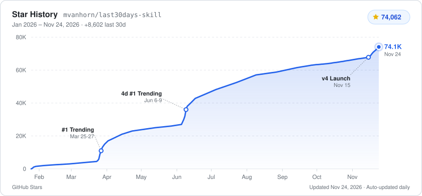

# /last30days

[English](README.md) | [Français](README.fr.md) | [Deutsch](README.de.md) | [Español](README.es.md) | [Português (Brasil)](README.pt-BR.md) | [日本語](README.ja.md) | [简体中文](README.zh-CN.md) | [العربية](README.ar.md) | [فارسی](README.fa.md) | [Türkçe](README.tr.md) | [Tiếng Việt](README.vi.md) | Русский

<p align="center">
  
</p>

<p align="center">
  <a href="https://github.com/mvanhorn/last30days-skill">
    
  </a>
  <br/>
  <a href="https://trendshift.io/repositories/21997" target="_blank">
    
  </a>
  <br/>
  <a href="https://github.com/mvanhorn/last30days-skill/actions/workflows/validate.yml">
    
  </a>
</p>

**Поисковик под управлением ИИ-агента. Порядок результатов задают апвоуты, лайки и реальные деньги, а не редакторы.**

Этот README описывает текущий конвейер v4. Спецификация скилла лежит в [skills/last30days/SKILL.md](skills/last30days/SKILL.md). Актуальное поведение команд и настройку задаёт она. Если README с ней расходится, верна спецификация.

**Claude Code (рекомендуем, обновляется сам через маркетплейс):**
```
/plugin marketplace add mvanhorn/last30days-skill
/plugin install last30days
```

**Codex, Cursor, Copilot, Gemini CLI и ещё 50+ хостов [Agent Skills](https://agentskills.io):**
```
npx skills add mvanhorn/last30days-skill -g
```
С флагом `-g` скилл ставится глобально и доступен во всех ваших проектах. Без флага скилл встанет только в текущий проект.

Другие способы установки (claude.ai в браузере, OpenClaw, вручную) описаны ниже, в разделе [Установка](#установка).

Конфигурация не нужна. Reddit, HN, Polymarket и GitHub работают сразу. Если вы ищете компанию, к ним добавляются патентные заявки и страницы вакансий. Запустите скилл один раз, и мастер настройки за 30 секунд подключит X, YouTube, TikTok, arXiv, Techmeme и другие источники.

---

Апвоуты на Reddit. Лайки в X. Транскрипты YouTube. Вовлечённость в TikTok. Коэффициенты Polymarket, за которыми стоят реальные деньги и инсайдерская информация. Каждый день миллионы людей голосуют вниманием и кошельком. /last30days параллельно ищет по всему этому, ранжирует находки по реальной реакции людей, а ИИ-агент в роли судьи собирает всё в одну сводку.

Google собирает мнения редакторов. /last30days ищет у людей.

Такого поиска больше нигде нет. Ни один ИИ не видит все эти платформы сразу. Поиск Google не видит комментарии на Reddit и посты в X. У ChatGPT есть договор с Reddit, но он не ищет по X и TikTok. У Gemini есть YouTube, но нет Reddit. У Claude из коробки нет ничего из этого. Каждая платформа замкнута в себе, и у каждой свои API, токены и авторизация. Но если подключить свои ключи и сессии браузера, ИИ-агент сможет искать по всем платформам сразу, оценивать находки в сравнении друг с другом и говорить, что на самом деле важно.

В этом и прорыв. Не ещё один поисковик получше, а дюжина разрозненных платформ, которые связал агент.

```
/last30days Peter Steinberger
```

Завтра у вас встреча. Вы гуглите человека и находите его профиль в LinkedIn, который не обновлялся с 2023 года. /last30days показывает, чем он занят в этом месяце: перешёл в OpenAI работать над Codex, оспаривает запрет Anthropic на сторонних агентов, открыл 23 PR (85% из них приняты), делает «LobsterOS» для управления агентами на разных устройствах, а спор в r/ClaudeCode о том, герой он или «невыносимый тип», набрал 569 апвоутов. Всё это разбросано по постам в X, тредам на Reddit, транскриптам YouTube и коммитам на GitHub. В Google ничего из этого не было.

## Зачем это нужно

Я сделал скилл, чтобы успевать за ИИ. Всё меняется каждый день, и гики с Reddit и X узнают об этом первыми. Мне нужны были промпты получше, а обучающие данные всегда отставали на месяцы от того, до чего сообщество уже додумалось.

Но скилл перерос эту задачу. Теперь я запускаю его перед звонком по продажам, чтобы знать, что на самом деле происходило с компанией последние 30 дней. Перед встречей, чтобы прочитать свежие твиты человека и транскрипты его подкастов. Перед поездкой в Disney World, чтобы знать, какие аттракционы закрыты и что сообщество думает о Genie+. Перед тем как начинать новый проект, чтобы знать, с какими проблемами люди сталкиваются на самом деле.

У вас встреча с CEO. Вы прочитали все его твиты и транскрипты на YouTube за последние 30 дней? Я прочитал.

## Источники, которые оценивают люди

| Источник | Что вам расскажут люди |
|--------|--------------------------|
| **Reddit** | Мнение без фильтров. Лучшие комментарии с реальным числом апвоутов, бесплатно и без API-ключа. Настоящие мнения, которые Google прячет. С вашего согласия скилл ищет и через ваш аккаунт Reddit. Так он находит больше тредов и видит живые оценки. |
| **X / Twitter** | Острое мнение, экспертный тред, первая реакция на новость. Здесь первыми узнают и первыми спорят. |
| **YouTube** | Разбор на 45 минут. Скилл ищет по полным транскриптам те 5 фраз, которые стоит процитировать. |
| **TikTok** | Автор, который донёс своё мнение до 3,6 млн человек, а в Google вы его не найдёте. |
| **Instagram Reels** | Взгляд инфлюенсеров с транскриптами речи. Сигнал визуальной культуры. |
| **Hacker News** | Консенсус разработчиков. 825 очков, 899 комментариев. Здесь по-настоящему спорят технари. |
| **Polymarket** | Не мнения, а коэффициенты, за которыми стоят реальные деньги. 96% уверенности в продажах альбома. 4% на сделку по поглощению. Отчёт ставит коэффициенты рынка одной строкой под историей, к которой они относятся, и показывает, насколько они сдвинулись. |
| **GitHub** | О человеке: темп PR, лучшие репозитории по звёздам, заметки к релизам. О теме: issues и обсуждения. |
| **Digg** | Кластеры историй из всех тем Digg (ИИ, технологии, мир и бизнес, спорт, наука, игры, развлечения), отсортированные по Digg Score, с цитатами из X и их авторами (авторизация в X не нужна). Включается сам, когда `digg-pp-cli` есть в PATH. Старая версия `digg-pp-cli` тоже работает, но только с ИИ и технологиями и без оценок. |
| **arXiv** | Статьи, которые стоят за хайпом. Свежие исследования за период, бесплатно и без API-ключа. Включается сам, когда `arxiv-pp-cli` есть в PATH (его ставит мастер настройки). |
| **Techmeme** | Технологические новости в подборке редакции, только за 30 дней исследования. Бесплатно и без API-ключа. Включается сам, когда `techmeme-pp-cli` есть в PATH (его ставит мастер настройки). |
| **Yahoo Finance** | Как рынок оценивает компанию. Изменение цены акций за 30 дней исследования в сравнении с S&P 500 для компаний с листингом в США. Бесплатно и без API-ключа. Появляется, если вы ищете публичную компанию или её руководителя, а `yahoo-finance-pp-cli` есть в PATH (его ставит мастер настройки). |
| **LinkedIn** | Профессиональный сигнал. Посты и статьи, причём статьи весят больше. |
| **Meta Ads** | Что бренд говорит в платной рекламе. Действующие объявления Meta, запущенные в этом месяце: тексты, промокоды и транскрипты речи. |
| **StockTwits** | Настроения трейдеров. Включается сам, если вы ищете тикер или криптовалюту. |
| **Threads** | Текстовый слой после Twitter. Разговоры авторов и брендов. |
| **Pinterest** | Визуальные находки. Пины, сохранения и комментарии о товарах и идеях. |
| **Xiaohongshu (RED)** | Китайские сигналы о стиле жизни, товарах и авторах. Подключается явно флагом `--search xhs`, когда локально работает залогиненный браузерный плагин x-mcp или сервис `xiaohongshu-mcp`. |
| **Juejin** | Статьи китайских разработчиков о том, что только что вышло, с ранжированием по лайкам, комментариям, сохранениям и просмотрам. Подключается флагом `--search juejin` или `INCLUDE_SOURCES=juejin`. Бесплатно, без API-ключа. |
| **V2EX** | Китайский форум разработчиков: треды и ответы из главных тем. Подключается флагом `--search v2ex` или `INCLUDE_SOURCES=v2ex`. Бесплатно, без API-ключа. |
| **Bluesky** | Децентрализованный социальный слой. Посты в AT Protocol после массового ухода из Twitter. |
| **Perplexity** | Управляемый синтез через Agent API, запасной вариант Sonar через OpenRouter, сырые строки Search API и Deep Research по явному запросу. |
| **DEV Community (dev.to)** | Статьи разработчиков и лучшие комментарии через открытый API без ключа. Подключается флагами `--devto-tags`, `--search devto` или `INCLUDE_SOURCES=devto`. |
| **Truth Social** | Поиск постов с `TRUTHSOCIAL_TOKEN`; доступен после авторизации. |
| **Telegram** | Публичные посты из указанных каналов. Подключается явно; нужны `SCRAPECREATORS_API_KEY` и список каналов. Поиска по ключевым словам нет. |
| **Trustpilot** | TrustScore компании, число отзывов и ИИ-обзор отзывов клиентов. Подключается явно; нужны `trustpilot-pp-cli` в PATH и рабочая сессия. |
| **Amazon** | Рейтинги товаров, цены и отзывы покупателей. Подключается явно; нужен залогиненный CLI `brightdata`; источник расходует ваши кредиты Bright Data. |
| **DripStack** | Финансовые рассылки и разборы аналитиков через открытый API без ключа. Подключается флагом `--search dripstack` или `INCLUDE_SOURCES=dripstack`. |
| **Страницы вакансий** | Кого нанимает компания, по данным её собственной страницы вакансий (Workday, Apple, Amazon, Google, Microsoft, Netflix, Oracle и другие). Если вы ищете компанию, скилл сам читает эту страницу. Вакансии, которые намекают на неанонсированные планы, он отмечает как секретные сигналы страницы вакансий (Jobs Page Secret Signals). Также подключается флагом `--hiring-signals`, `--search jobs` или через план исследования. |
| **Патенты** | Новые патентные заявки компании в США. По ним видно, над чем компания работает ещё до выпуска. Бесплатно и без API-ключа. Появляется, если вы ищете компанию. Заявка становится патентным секретным сигналом (Patent Secret Signal), только если она нетипична для компании или описывает то, что компания ещё не выпустила и не анонсировала. |
| **Локальный корпус** | Ваши локальные файлы Markdown и текстовые файлы, а также PDF, если `pdftotext` есть в PATH. Подключается флагом `--corpus` или `LAST30DAYS_CORPUS_DIRS`. |
| **Веб** | Редакционные публикации и сравнения в блогах. Один сигнал из многих, а не единственный. |

Попросите `/last30days` включить нужные вам источники. Доступность зависит от ключей, установленных инструментов, темы и явных подключений. Настройка описана в разделе [требований к источникам](CONFIGURATION.md#source-requirements).

Тред на Reddit с 1500 апвоутами — более сильный сигнал, чем пост в блоге, который никто не прочитал. TikTok с 3,6 млн просмотров больше говорит о том, что важно для культуры, чем пресс-релиз. С коэффициентами Polymarket, за которыми стоят ставки на $66 тыс., спорить труднее, чем с догадкой эксперта.

Сводка ранжирует находки по тому, на что реально отреагировали люди. Социальная релевантность, а не SEO-релевантность.

## Для чего скилл используют на самом деле

**Перед встречей.** `/last30days Peter Steinberger`: перешёл в команду Codex в OpenAI, оспаривает запрет Anthropic на сторонних агентов, 23 PR на GitHub (85% из них приняты), делает LobsterOS для управления агентами на разных устройствах. r/ClaudeCode: «С самого выхода OpenClaw все знали: если запускать его не через API, рано или поздно тебя забанят» (227 апвоутов). В LinkedIn такого нет.

**Чтобы узнать, над чем работает компания, ещё до выпуска.** `/last30days Apple`: секретный сигнал страницы вакансий отметил новую директорскую роль. Человек на этой роли проверяет, приводят ли запросы к транзакциям через API партнёров и финансовые системы. Похоже на контроль качества для ассистента, который сам совершает покупки. Патентный секретный сигнал отметил заявку, в которой устройством управляют касанием по его изображению на сохранённом фото комнаты. Polymarket даёт 91% на то, что на конец года Apple будет крупнейшей компанией мира. `/last30days Alphabet` нашёл вакансию продакт-менеджера для «YouTube Ads Agentic Buyflows». Строка Yahoo Finance показала падение на 17,6% за 30 дней, а S&P 500 за то же время упал на 3,6%. Худшим днём стало 29 октября (−12,6%). Для отчёта только о найме добавьте `--hiring-signals`.

**Чтобы найти тему до пика.** Спросите `/last30days what's exploding in AI agents?`, и скилл перейдёт в режим поиска тем. Движок проходит по спискам категорий Reddit, главной странице и лучшим историям Hacker News, историям Digg и X, если есть авторизация. Ваш агент оценивает кандидатов (названия, отсев мусора, ценность для контента) и пишет идеи для подкаста или статьи в X. В итоге вы получаете 5–10 тем, отсортированных по скорости роста. У каждой темы есть цифры по разным источникам, метка динамики и готовая к запуску команда `/last30days "<topic>"`.

**Когда что-то выходит.** `/last30days Kanye West`: Великобритания отказала ему в визе, Wireless Festival отменили, спонсоры разбежались. Но BULLY дебютировал на 2-м месте в Billboard. Fantano вернулся из «отпуска от Йе», чтобы сделать обзор (653 тыс. просмотров). На концерте SoFi Homecoming к Канье вышли Lauryn Hill и Travis Scott, а в сете было 44 песни. Polymarket: «Будет ли Канье снова писать в твиттер?» — 86% «да». 23 треда на Reddit, 17 видео на YouTube, 86 тыс. апвоутов.

**Чтобы сравнить инструменты.** `/last30days OpenClaw vs Hermes vs Paperclip`: «Это не конкуренты, это слои». OpenClaw — исполнитель (351 тыс. звёзд на GitHub, живые данные), Hermes — самообучающийся мозг (31 тыс. звёзд), Paperclip — оргструктура (49 тыс. звёзд). Число звёзд берётся из API GitHub в реальном времени, а не из устаревших постов в блогах. Сравнительная таблица: архитектура, память, безопасность, для чего подходит лучше всего. По словам @IMJustinBrooke, «OpenClaw = Чармандер, Hermes = Чаризард».

**Чтобы понять, что происходит в мире.** `/last30days Iran vs USA`: 38-й день войны. Трамп дал Ирану срок до вторника, чтобы снова открыть Ормузский пролив. Сбиты два американских военных самолёта. Нефть по $126 за баррель. МЭА назвало это «крупнейшим перебоем поставок в истории мирового нефтяного рынка». Polymarket: перемирие до 31 декабря — 74%. 27 постов в X, 10 видео на YouTube, 20 рынков прогнозов.

**Перед поездкой.** `/last30days Universal Epic Universe`: расширение уже строится. Подано разрешение на «Project 680». Шоу фейерверков ещё не анонсировали, но под него уже построили инфраструктуру. Очередь на Mine-Cart Madness в среднем 148 минут. Годового абонемента пока нет, и местные недовольны. Stardust Racers закрыт на ремонт до 5 апреля.

**Чтобы быстро чему-то научиться.** `/last30days Nano Banana Pro prompting`: промпты со структурой JSON вытесняют кашу из тегов. Вложенный формат @pictsbyai не даёт понятиям «перетекать» друг в друга. Править результат лучше, чем генерировать заново. Затем скилл пишет вам готовый промпт по приёмам, которые, по словам сообщества, работают.

## Что нового

v4 узнаёт, что делает компания, ещё до анонса, а каждый отчёт теперь проще цитировать:

- Патентные секретные сигналы: если вы ищете компанию, скилл без ключа читает её патентные заявки в США за месяц. Он отмечает только нетипичные заявки и те, что описывают неанонсированное.
- Секретные сигналы страницы вакансий: скилл читает собственную страницу вакансий компании и отмечает роли, которые выдают будущие планы, включая новые команды, о которых ещё никто не писал.
- Строки с цитатами: лучшие комментарии с Reddit, X, YouTube, TikTok и Instagram стоят отдельной строкой под историей, которую подкрепляют, с переводом, если нужно. Цитировать можно и фразу из видео.
- Коэффициенты Polymarket одной строкой: они стоят под историей, к которой относятся, и показывают свой сдвиг.
- Строка Yahoo Finance: цена акций публичной компании за последние 30 дней в сравнении с S&P 500 и самое резкое изменение за один день.
- Понимает, кого вы имеете в виду: по слову «Apple» скилл сам находит компанию, её сайт и тикер.
- Reddit от вашего имени: с вашего согласия скилл ищет на Reddit через ваш залогиненный аккаунт.
- Digg теперь покрывает все темы, а не только ИИ и технологии.

Текущая опубликованная версия — в [последнем релизе](https://github.com/mvanhorn/last30days-skill/releases/latest), изменения по версиям — в [CHANGELOG.md](CHANGELOG.md). Невыпущенные изменения в основной ветке записаны в [changelog.d/](changelog.d/).

Этот README описывает текущий исходный код; установленная у вас версия может отличаться.

## Установка

| Где | Установка | Обновления |
|---------|---------|---------|
| **Claude Code** (рекомендуем) | `/plugin marketplace add mvanhorn/last30days-skill` | Сами через маркетплейс или `claude plugin update last30days@last30days-skill` |
| **Grok** (xAI Build CLI) | `grok plugin marketplace add mvanhorn/last30days-skill`, затем `grok plugin install last30days` | `grok plugin update last30days` |
| **Grok Bot** | [Добавьте из маркетплейса Grok Bot](https://x.ai/bot/marketplace/bots/last30days) | Управляет маркетплейс |
| **Codex, Cursor, Copilot, Gemini CLI и ещё 50+ хостов [Agent Skills](https://agentskills.io)** | `npx skills add mvanhorn/last30days-skill -g` | `npx skills update last30days -g` |
| **claude.ai** (в браузере) | [Скачайте `last30days.skill`](https://github.com/mvanhorn/last30days-skill/releases/latest/download/last30days.skill) и загрузите через claude.ai > Customize > Skills > + > Create skill > Upload a skill | Скачайте и загрузите заново |
| **Claude Desktop** | [Скачайте `.mcpb` для своей платформы](https://github.com/mvanhorn/last30days-skill/releases/latest) и перетащите в Settings > Extensions | Скачайте и перетащите новый пакет |
| **OpenClaw** | `clawhub install last30days-official` | `clawhub update last30days-official` |

### Claude Code (рекомендуем)

```
/plugin marketplace add mvanhorn/last30days-skill
```

Рекомендуем этот способ: маркетплейс Claude Code сам подтягивает новые релизы, потому что кеш плагина привязан к версии. Чтобы проверить обновления принудительно, запустите `claude plugin update last30days@last30days-skill`.

Если в Claude Code вам удобнее установка через agent-skills, она тоже поддерживается:

```
npx skills add mvanhorn/last30days-skill -g -a claude-code
```

### Попробовать по ссылке

[Попробуйте скилл Last30Days Research в Telegram или WhatsApp](https://app.clawmama.run/skills/2ne05f/hermes?utm_source=github&utm_medium=issue&utm_campaign=skill_outreach_mvanhorn_last30days_skill)

Нативный плагин и копию скилла через `npx skills` можно поставить одновременно. Но Claude Code не убирает дубли между способами установки: если активны и плагин из маркетплейса, и копия из `npx skills`, `/last30days` появится дважды. Используйте один способ установки на одной машине.

### Grok (xAI Build CLI)

[Grok Build](https://docs.x.ai/build/features/skills-plugins-marketplaces) (`grok`) ставит last30days как нативный плагин. При прямой установке плагин обновляется вслед за репозиторием:

```bash
grok plugin install mvanhorn/last30days-skill
```

Или добавьте этот репозиторий как источник маркетплейса и установите плагин по имени:

```bash
grok plugin marketplace add mvanhorn/last30days-skill
grok plugin install last30days
```

Добавьте `--trust`, чтобы пропустить подтверждение установки. Обновить плагин можно командой `grok plugin update last30days`. Для совместимости Grok читает и манифесты Claude Code, но основной путь — собственные манифесты Grok в `.grok-plugin/` (на них указывает и листинг в официальном [маркетплейсе xAI](https://github.com/xai-org/plugin-marketplace)). `npx skills add` остаётся рабочим запасным вариантом для любых хостов. В [Grok Bot](https://x.ai/bot/marketplace/bots/last30days) last30days ставится из маркетплейса, и X там работает сразу. Сначала скилл берёт встроенные инструменты бота для X, затем его коннектор X, а при необходимости официальный X API (`X_BEARER_TOKEN`).

### Codex, Cursor, Copilot, Gemini CLI и другие хосты Agent Skills

Установите через открытый CLI [Agent Skills](https://agentskills.io). Он поддерживает 50+ хостов, среди них `codex`, `cursor`, `github-copilot`, `gemini-cli`, `claude-code`, `windsurf`, `cline`, `continue`, `roo`, `aider-desk`, `opencode`, `goose` и другие (полный список — в [репозитории vercel-labs/skills](https://github.com/vercel-labs/skills)).

```bash
npx skills add mvanhorn/last30days-skill -g
```

Флаг `-g` (global) ставит скилл в папку пользователя, и он доступен во всех проектах. Без флага `-g` команда `npx skills` ставит скилл в папку проекта `./.skills/`, и он попадает в коммиты репозитория. Для инструмента, который исследует весь мир, нужна глобальная установка.

Codex desktop и другие хосты с режимом папок могут работать не только в Git-репозиториях, но и в обычных папках. Чтобы заранее узнать, что запуск прочитает и запишет, выполните встроенный `scripts/last30days.py --preflight` из папки загруженного скилла. В клоне исходников та же команда — `python3 skills/last30days/scripts/last30days.py --preflight`. Она показывает, откуда взята конфигурация, план чтения cookies браузера, файлы, которые запуск запишет, необязательные команды и проигнорированную конфигурацию проекта. При этом она не читает cookies, не пишет файлы и не запускает исследование. Мастеру настройки она не нужна.

По умолчанию скилл ставится в тот хост, который обнаружит `npx skills`. Чтобы выбрать конкретный хост (или несколько):

```bash
npx skills add mvanhorn/last30days-skill -g -a codex
npx skills add mvanhorn/last30days-skill -g -a cursor
npx skills add mvanhorn/last30days-skill -g -a gemini-cli
npx skills add mvanhorn/last30days-skill -g -a codex -a cursor
```

Обновить позже:

```bash
npx skills update last30days -g
```

Или обновить всё, что установлено глобально через `npx skills`:

```bash
npx skills update -g
```

Посмотреть список и удалить скилл можно командами `npx skills list -g` и `npx skills remove last30days -g`.

### DeepSeek Harness

[DeepSeek Harness](https://github.com/deepseek-ai/deepseek-harness) (DSH) загружает скиллы из `~/.agents/skills` (или из `$DSH_AGENTS_HOME/skills`, если переменная задана). Именно туда глобальная установка `npx skills add mvanhorn/last30days-skill -g` выше кладёт last30days, поэтому DSH подхватит скилл без дополнительной настройки. После установки перезапустите DSH.

### claude.ai (в браузере)

1. [Скачайте `last30days.skill`](https://github.com/mvanhorn/last30days-skill/releases/latest/download/last30days.skill) из последнего релиза.
2. Откройте [claude.ai > Customize > Skills](https://claude.ai/customize/skills).
3. Нажмите кнопку `+` на панели Skills > `Create skill` > `Upload a skill` и выберите или перетащите файл.

Сначала включите «Code execution and file creation» в разделе Capabilities, иначе скиллы не запустятся.

### Claude Desktop

Claude Desktop ставит `/last30days` как MCP-сервер из пакета `.mcpb` (формат Model Context Protocol для установки в один клик).

1. Откройте [последний релиз](https://github.com/mvanhorn/last30days-skill/releases/latest) и скачайте `.mcpb` для своей платформы:
   - macOS Apple Silicon: `last30days-pp-mcp-darwin-arm64.mcpb`
   - macOS Intel: `last30days-pp-mcp-darwin-amd64.mcpb`
   - Linux x86_64: `last30days-pp-mcp-linux-amd64.mcpb`
2. Откройте Claude Desktop, перейдите в Settings > Extensions и перетащите туда файл.
3. Когда появится запрос, вставьте API-ключи для источников, которые хотите включить. Все поля необязательные. Если пропустить их все, движок перейдёт в режим только веб-поиска. Ключи хранятся в связке ключей вашей ОС.
4. Перезапустите Claude Desktop. Попросите Claude «research Peter Steinberger» или назовите любую другую тему, и он вызовет инструмент `research`.

**Требование к системе:** Python 3.12+ в PATH. Пакет содержит исходники движка, но использует ваш локальный интерпретатор Python. На Windows установите Python с [python.org](https://www.python.org/downloads/); в macOS и большинстве дистрибутивов Linux подходящая версия уже есть.

**Ключи не синхронизируются со скиллом в Claude Code.** Claude Desktop и Claude Code специально хранят учётные данные раздельно. Если вы уже настроили `~/.config/last30days/.env` для скилла в Claude Code, здесь те же ключи придётся ввести ещё раз.

Поддержка Windows отложена, пока не появятся точки входа манифеста для каждой платформы; следите за этим в отдельном issue.

### OpenClaw

```bash
clawhub install last30days-official
```

Для действий в X/Twitter за пределами исследований `/last30days`, например публикации
твитов и ответов, выгрузки подписчиков, работы с медиа, мониторинга и розыгрышей,
используйте [TweetClaw](https://github.com/Xquik-dev/tweetclaw) как сопутствующий
плагин OpenClaw. TweetClaw поддерживает команда Xquik-dev. Он упомянут только как
необязательное дополнение, а не как зависимость last30days или рекомендация.

### Вручную (для разработчиков)

```bash
git clone https://github.com/mvanhorn/last30days-skill.git
ln -s "$(pwd)/last30days-skill/skills/last30days" ~/.claude/skills/last30days
```

Благодаря симлинку установка всегда совпадает с рабочей копией. Правки видны сразу, копировать заново не нужно. Для `claude.ai` соберите файл `.skill` из исходников: `bash skills/last30days/scripts/build-skill.sh` создаёт `dist/last30days.skill`.

Reddit (с комментариями), Hacker News, Polymarket и GitHub работают сразу. Если вы ищете компанию, к ним добавляются патентные заявки и страницы вакансий. Конфигурация не нужна. Запустите `/last30days` один раз, и мастер настройки за 30 секунд подключит больше источников, включая бесплатные CLI для arXiv и Techmeme.

## Свои ключи

Эти платформы не связаны друг с другом. X не знает, что думает Reddit. YouTube не видит TikTok. Но если подключить свои API-ключи и токены браузера, у вас сразу появится доступ ко всем платформам.

| Источники | Что нужно | Стоимость |
|---------|---------------|------|
| Reddit (с комментариями) + HN + Polymarket + GitHub + StockTwits + патентные заявки и страницы вакансий компании | Ничего | Бесплатно |
| arXiv + Techmeme + Yahoo Finance | Бесплатные CLI, их ставит мастер настройки | Бесплатно |
| X / Twitter | Задайте `X_BEARER_TOKEN` для официального X API (свежие посты примерно за последнюю неделю, если у вашего проекта разработчика X нет доступа к полному архиву; в Grok Bot это запасной вариант после встроенных инструментов бота для X, в остальных местах подключается через `LAST30DAYS_X_BACKEND=xapi`), или войдите на x.com в любом браузере, или задайте `XQUIK_API_KEY` / `XAI_API_KEY` | Кредиты X API списываются с вашего проекта разработчика X; cookies браузера бесплатны; другие ключи зависят от провайдера |
| YouTube | `brew install yt-dlp` | Бесплатно |
| Bluesky | Пароль приложения с bsky.app | Бесплатно |
| TikTok + Instagram + Threads + Pinterest + LinkedIn + комментарии YouTube | Ключ ScrapeCreators | 10 000 бесплатных вызовов, дальше оплата по факту |
| TikTok (и Instagram, по возможности) без ключа | `yt-dlp`, используется, когда ключ ScrapeCreators не задан; меньше результатов, без комментариев | Бесплатно |
| Xiaohongshu (RED) | Запустите залогиненный браузерный плагин x-mcp или сервис `xiaohongshu-mcp` и подключите источник флагом `--search xhs` на один запуск или `INCLUDE_SOURCES=xiaohongshu` в `.env`; last30days сам проверяет `http://localhost:18060`, затем `http://host.docker.internal:18060`, а для своего адреса есть `XIAOHONGSHU_API_BASE` | API-ключ last30days не нужен; зависит от вашего локального сервиса с сессией браузера |
| DripStack (премиальные финансовые рассылки) | Подключается явно: `--search dripstack` на один запуск или `INCLUDE_SOURCES=dripstack` в `.env` | Без ключа; бесплатный открытый API поиска |
| Perplexity Agent API / Search API / Deep Research | Ключ Perplexity или ключ OpenRouter как запасной вариант Sonar | Оплата по факту; прямой ключ включает Agent API и фоновый Deep Research |
| Веб-поиск | Ключ Brave Search | 2000 бесплатных запросов в месяц |

### Связка ключей macOS (необязательно)

В macOS ключи можно хранить в системной связке ключей вместо файла `.env`. Скилл сам подхватывает их как уровень настроек с самым низким приоритетом, а при совпадении побеждают файлы `.env` и окружение процесса.

```bash
# Interactive setup — prompts for each known key, skip with empty input
skills/last30days/scripts/setup-keychain.sh

# Or store a single key by hand
security add-generic-password -a "$USER" -s last30days-XAI_API_KEY -w "xai-..."

# Inspect / clean up
skills/last30days/scripts/setup-keychain.sh --list
skills/last30days/scripts/setup-keychain.sh --delete XAI_API_KEY
```

Записи хранятся под именем сервиса `last30days-<KEY>` для текущего пользователя. На всех платформах, кроме Darwin, загрузчик ничего не делает, поэтому для пользователей Linux и Windows поведение не меняется.

Ключи уже лежат в связке под другими именами сервисов? Вместо копирования секретов задайте несекретное сопоставление `LAST30DAYS_KEYCHAIN_ALIASES`, описанное в [CONFIGURATION.md](CONFIGURATION.md#reusing-existing-macos-keychain-items).

Полная таблица ключей по источникам, приоритет провайдеров рассуждений и приоритет бэкендов веб-поиска описаны в [CONFIGURATION.md](CONFIGURATION.md).

## Настройка

Две вещи, которые вам, скорее всего, понадобятся в первый же день:

**Куда сохраняются файлы исследований.** По умолчанию `LAST30DAYS_MEMORY_DIR` указывает на `~/Documents/Last30Days/` (Windows: `C:\Users\<you>\Documents\Last30Days\`). Чтобы изменить путь, задайте эту переменную окружения в своей оболочке или передайте `--save-dir <path>` на один запуск. Если результат нужен по точному пути, используйте `--output <file>`; формат задаёт `--emit`. Чтобы разделять несколько вариантов одной темы (например, по клиентам), используйте `--save-suffix=<name>`. Каждый запуск с `--save-dir` создаёт `<slug>-raw[-suffix].md`. Если хотите проверить, какие файлы запишет запуск, не начиная исследования, выполните `python3 skills/last30days/scripts/last30days.py --preflight`.

**Структурированный вывод для агентов и процессов.** Попросите у `/last30days` машиночитаемый JSON, и вы получите стабильный версионированный профиль для агентов. Для прямого использования движка в скриптах или при разработке запустите `python3 skills/last30days/scripts/last30days.py "AI coding agents" --emit=json`; добавляйте `--json-profile=raw`, только если нужен неверсионированный внутренний дамп `Report`. Подробнее — в [справочнике полей экспорта JSON и правилах версионирования](docs/reference/json-export.md).

**Поиск тем с нуля.** Спросите `/last30days what's trending in AI agents?`, чтобы получить ранжированную сводку новых тем, а не исследование уже известной вам темы. На хосте агента запрос запускает протокол из трёх команд, и оценку делает сам хост: модель называет темы, отсеивает мусор, оценивает ценность и пишет идеи для контента. Для прямого использования движка в скриптах или cron запустите `python3 skills/last30days/scripts/last30days.py --discover "AI agents"` (один проход, детерминированные названия тем, без идей); добавьте `--emit=json` для версионированного контракта поиска тем. Поиск тем нельзя сочетать с позиционной темой и `--drill`.

**Слежение за трендами между запусками.** По умолчанию каждый запуск создаёт свежий снимок в Markdown. Чтобы копить находки со временем, добавьте `--store`, и данные сохранятся в базу SQLite. Затем используйте [`scripts/watchlist.py`](skills/last30days/scripts/watchlist.py) для запусков по расписанию (с необязательной доставкой новых находок в Slack или вебхук) и [`scripts/briefing.py`](skills/last30days/scripts/briefing.py) для ежедневных и еженедельных дайджестов. Полная схема регулярных запусков — в [CONFIGURATION.md](CONFIGURATION.md#trend-monitoring-store--watchlist--briefings).

**Библиотека исследований, на которую можно подписаться.** Попросите `/last30days` собрать ленту библиотеки. Для скриптов и разработки запустите `python3 skills/last30days/scripts/last30days.py library feed` напрямую. Команда превращает сохранённые сводки в `index.html`, локальную ленту Atom `feed.xml` и страницы сводок для чтения. Добавляйте `--publish`, только если хотите разместить HTML-индекс и страницы сводок в сети; публикация включается только по запросу, а опубликованные страницы по умолчанию открыты всем. Чтобы на ленту Atom можно было подписаться, разместите папку с результатом на статическом хостинге, например GitHub Pages.

**Поиск по всему, что вы исследовали.** Спросите `/last30days search my library for MCP servers` или `/last30days have I researched MCP servers before?`. Для прямого использования движка запустите `python3 skills/last30days/scripts/last30days.py library search "MCP servers"`. Поиск работает офлайн и детерминированно: он постепенно индексирует те же сохранённые сводки, что и лента библиотеки, объединяет подходящие находки из хранилища запусков и группирует результаты по теме и дате. Если прошлые исследования пересекаются с текущей темой, новые запуски также показывают компактный раздел **From your library**; чтобы отключить этот пассивный контекст, задайте `LAST30DAYS_LIBRARY_CONTEXT=off`.

Скрипты-обёртки для отдельных клиентов, свои сабреддиты для сравнения по категориям и экспериментальный бета-канал для незавершённых доработок тоже описаны в [CONFIGURATION.md](CONFIGURATION.md).

## Витрина: ленты исследований от сообщества

Публикуете с помощью last30days регулярные новости об ИИ, обзор рынка или ленту о своей любимой узкой теме? Поделитесь ссылкой на открытую библиотеку (или ссылкой на Atom после размещения `feed.xml` на статическом хостинге) в [треде витрины сообщества](https://github.com/mvanhorn/last30days-skill/issues/532). Ссылки на ленты появятся здесь, когда авторы их пришлют, а пока всё собирается в этом треде.

## Как это работает

1. **Вы вводите тему.** Человек, компания, продукт, технология, «X vs Y». Что угодно.
2. **Агент определяет, кто важен.** Находит аккаунты в X (включая основателей), репозитории на GitHub, сабреддиты, хэштеги TikTok, каналы YouTube. Для «Kanye West» он знает r/hiphopheads, @kanyewest и «bully review» на YouTube. Для «OpenClaw» он находит openclaw/openclaw на GitHub и получает живое число звёзд.
3. **Поиск по всем источникам параллельно.** Из одного запроса получается несколько. Результаты оцениваются по вовлечённости, релевантности и свежести.
4. **Глубина, которой нет больше ни у кого.** Полные транскрипты видеореакций на YouTube. Лучшие комментарии Reddit с числом апвоутов. Подписи в TikTok. Коэффициенты Polymarket. Не только заголовки и ссылки.
5. **Одна история — один кластер.** Wireless Festival анонсировали на Reddit, обсуждали в X, а цены на билеты показывали в TikTok. Это один кластер, а не три разные записи.
6. **Всё собирается в одну сводку.** На конкретных данных. Со ссылками на источники. С ранжированием по реальной реакции людей. Не «вот что я нашёл», а «вот что важно».
7. **Потом скилл становится вашим экспертом.** После одного запуска ваша сессия Claude знает всё, что знает сообщество. Задавайте уточняющие вопросы. Просите написать промпт или черновик письма, спланировать поездку, спроектировать систему, и всё это на основе того, что реально происходит прямо сейчас.

## Что говорят люди

> «Я нашёл скилл для Claude Code, который исследует любую тему на Reddit, X, YouTube и HN за последние 30 дней. А потом пишет за тебя промпты. Перед каждым текстом я вручную искал материал на Reddit и X. Вкладка за вкладкой. Тред за тредом. Вот на что уходит 90 минут. Скилл избавляет от этой работы». — @itsjasonai

> «Этот скилл заменил весь мой процесс исследования. Даёшь ему тему, а он собирает с Reddit, X и из веба то, о чём люди на самом деле говорят. Не старые посты в блогах. Настоящие разговоры за последние 30 дней». — @itswilsoncharles

> «5 из 10 трендовых репозиториев на GitHub сегодня — инструменты для Claude. №1: mvanhorn/last30days-skill». — @yieldhunter95

## Открытый исходный код

Лицензия MIT. Без трекинга. Без аналитики. Ваши исследования остаются на вашей машине (подробнее в разделе «Работа с данными» ниже).

Команды для тестов описаны в [CONTRIBUTING.md](CONTRIBUTING.md#tests).

Сделано на Python 3.12+, yt-dlp, Node.js (встроенный клиент Bird для поиска по X) и API ScrapeCreators. Архитектуру движка v3 разработал [@j-sperling](https://github.com/j-sperling).

Как открыть PR, описано в [CONTRIBUTING.md](CONTRIBUTING.md). Полный список участников сообщества — в [CONTRIBUTORS.md](CONTRIBUTORS.md), история версий — в [CHANGELOG.md](CHANGELOG.md).

## Работа с данными

По умолчанию скилл работает целиком на вашей машине. Данные уходят только в те API поиска, которые вы вызываете (Reddit, ScrapeCreators и другие).

**Переранжирование.** В режиме `auto` по умолчанию движок использует доступные учётные данные для выбора провайдера рассуждений. Сюда входят ключи, унаследованные из вашей оболочки (`OPENAI_API_KEY`, `XAI_API_KEY`, `OPENROUTER_API_KEY`, `GOOGLE_API_KEY`, `GEMINI_API_KEY` или `GOOGLE_GENAI_API_KEY`), в том числе заданные для другого инструмента. Если провайдер выбран, движок отправляет ему тему исследования и отобранные фрагменты для оценки релевантности. Когда ни один провайдер рассуждений недоступен, оценка остаётся локальной. Порядок выбора и способ оставить переранжирование локальным описаны в разделе [приоритет провайдеров рассуждений](CONFIGURATION.md#reasoning-provider-priority).

**Локальное хранилище.** Если задано `LAST30DAYS_STORE=1`, находки попадают в локальную базу SQLite `research.db` в текущей папке сохранения (`--save-dir` приоритетнее `LAST30DAYS_MEMORY_DIR`). Если папка сохранения не задана, база лежит в `~/.local/share/last30days/research.db`. Включённое хранилище не выгружает базу на удалённый сервис. Сроки хранения и очистка описаны в [CONFIGURATION.md](CONFIGURATION.md#--store-flag). Там же сказано, что перед удалением базы нужно остановить все процессы, которые её используют.

## История звёзд

<a href="https://github.com/mvanhorn/last30days-skill/stargazers">
  <picture>
    <source media="(prefers-color-scheme: dark)" srcset="https://raw.githubusercontent.com/mvanhorn/last30days-skill/star-history-assets/star-history-dark.svg" />
    <source media="(prefers-color-scheme: light)" srcset="https://raw.githubusercontent.com/mvanhorn/last30days-skill/star-history-assets/star-history-light.svg" />
    
  </picture>
</a>

---

**@slashlast30days** · [github.com/mvanhorn/last30days-skill](https://github.com/mvanhorn/last30days-skill)
