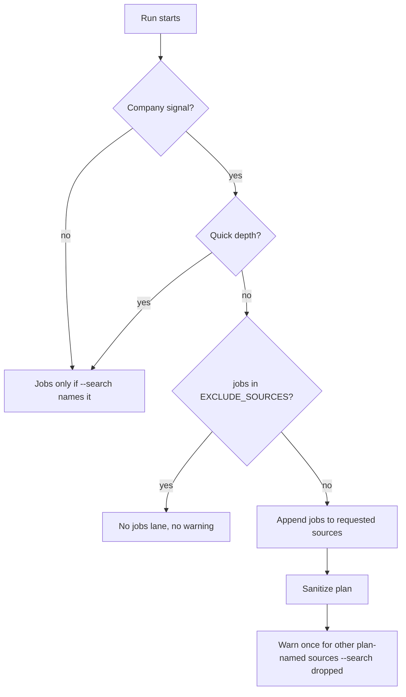
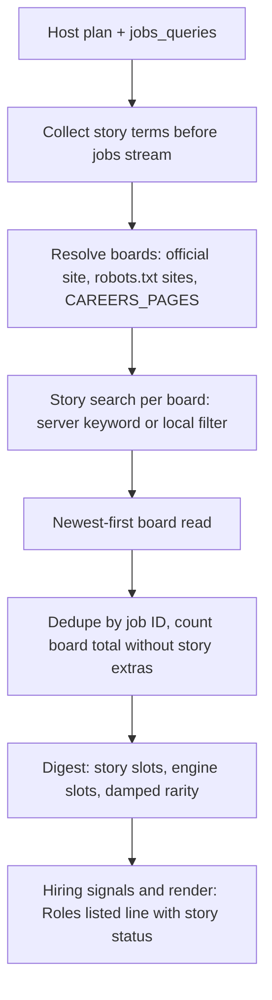

# Jobs Page Secret Signals That Actually Find The Story - Plan

## Goal Capsule

- Objective: On a company run, the Jobs Page Secret Signals section names the strategic postings a person reading the company's own job board would call the story, or is omitted when there is none. Three v4.2.1 runs (Amazon, Nike, Nothing) returned nothing usable even though each board held a clear story.
- Means: keep the jobs lane on under `--search` (KTD1), read every board a company actually uses (KTD3, KTD4), and search those boards for the run's own stories before ranking (KTD5-KTD8).
- Authority: Product Contract R-IDs govern behavior; KTDs govern mechanism within them. `references/hiring-signals.md` stays the synthesis rulebook and is edited, not replaced.
- Execution profile: Deep. One PR against `mvanhorn/last30days-skill` `main`. Units U1-U8 are code and docs; U9 is live verification and gates the PR description, not the merge.
- Stop conditions: stop and report if the runbook edit in U7 cannot be made byte-neutral under `tests/test_skill_progressive_disclosure.py`; stop if a board needed for R3-R5 requires a key, login, or a host outside the robots and ToS posture in `SECURITY.md`.
- Finishes: the executor opens the PR (Matt's standing authorization covers opening it) with the U9 old-vs-new table in the body.

---

## Product Contract

### Summary

The engine fixes three failures. It keeps the jobs lane on company runs when the host passes `--search`, and warns when `--search` drops any source the plan named. It reads every Workday site on a tenant and adds a Kula reader so Nike and Nothing boards are fully read. It searches each board for terms drawn from the run's own stories, and reserves digest slots for those matches ahead of the generic rarity ranking that filled Amazon's digest with IT Support roles. The Jobs Page Secret Signals section stays written only from the engine digest.

### Problem Frame

Each run failed differently, and no single fix covers all three.

- Nike: the host passed an explicit `--search` list, which is replace-not-add, so the jobs lane never ran. Run by hand, the engine read only the `nke2` Workday site (461 store roles) and missed `nke` (683 corporate roles), where the DOTSWOOSH GM and six Air Manufacturing Innovation automation roles sit.
- Nothing: the board runs on Kula (`careers.kula.ai`, mirrored at `join.nothing.tech`). The engine has no Kula reader, so there was no digest. The Labs subscription team (Growth Lead, Product Manager) and three AI Native San Francisco roles were the story.
- Amazon: the board was read, but `select_roles` rarity scoring rewarded one-off locations and title tails, and fallback-ranked IT Support roles took the engine slots. The Agentic Payments leadership roles (Head of Alternate Payment Methods, Global Head for CX & Risk) and the 41-role Fauna Robotics humanoid team never reached the digest.

### Key Decisions

- Jobs runs on company runs even under `--search`; `EXCLUDE_SOURCES=jobs` is the opt-out. Governs R1, R2. (session-settled: user-approved, chosen over honoring `--search` literally: hosts routinely pass full source lists and silently lose the lane.)
- The section stays engine-fed only; the host never hand-builds it from a board the engine could not read. Governs R11. (session-settled: user-approved, chosen over letting the host fill gaps by hand: a hand-built section cannot be checked or reproduced.)
- Verification uses live reruns plus a holdout set checked only at the end. Governs R13, R14. (session-settled: user-directed, chosen over fixture-only proof: the user asked to "also pick other companies to test on".)

### Requirements

Lane coverage

- R1. On a run the engine classifies as a company (or the person who leads one), above quick depth, the jobs lane runs even when `--search` omits `jobs`, unless `EXCLUDE_SOURCES` lists `jobs`.
- R2. When `--search` removes a source the host plan named, the run log names each dropped source once, so the host can see what it lost. Engine-attached sources (`grounding`, `corpus`, `perplexity`, `amazon`, `meta_ads`) and past-window skips never trigger it.

Board coverage

- R3. When a company's Workday tenant has several career sites, every site the company owns is read, and a posting listed on two sites counts once.
- R4. A company whose board runs on Kula, through `careers.kula.ai/<slug>` or a registered custom domain such as `join.nothing.tech`, gets a digest with title, team, location, and posting URL for each role.

Story targeting

- R5. Before ranking, the engine searches each readable board for 2 to 4 terms drawn from the run's own stories, sent by the host plan or derived by the engine when the host sends none.
- R6. Roles matching a story term take reserved digest slots ahead of roles chosen by generic scoring, and the digest says which term each matched.
- R7. Story matches never inflate the board's open-role count, and a board where story search found nothing is labeled differently from one where it was not attempted.
- R8. Story search never makes a run fail or blocks the rest of the jobs read; a throttled or slow board degrades to the existing newest-first read with a partial flag.

Ranking quality

- R9. On boards with more than 500 open roles, a one-off location or a one-off title phrase alone no longer earns a role a digest slot.
- R10. The new-geography hiring signal fires only for a location that is new to the company, not for a variant spelling or sub-site of an existing one, and the specialized-role flag no longer fires on any comma tail.

Synthesis

- R11. The Jobs Page Secret Signals section is written only from the engine digest; when the digest has no qualifying signal, the section is omitted.
- R12. `references/hiring-signals.md` tells the model that story-matched roles are the first place to look, and that a story-matched role still needs the existing 2-of-3 tests or test 4 to qualify.

Verification

- R13. Rerun on Amazon, Nike, and Nothing with the new engine, each digest contains the hand-found roles listed in the Verification Contract.
- R14. On the holdout set (OpenAI, Stripe, Apple, Microsoft, Walmart, Rivian, Salesforce), each digest contains the roles found by hand before the new engine first ran on them, or the section is correctly omitted.

### Acceptance Examples

- AE1. Covers R1, R2.
  - Given: `/last30days Nike` with `--search reddit,x,youtube,web`.
  - When: the engine plans and runs.
  - Then: the jobs lane runs and the log says the plan named `jobs` and that `--search` would have dropped it. With `EXCLUDE_SOURCES=jobs`, the lane does not run and no warning prints.
- AE2. Covers R3.
  - Given: Workday tenant `nike` with sites `nke`, `nke2`, `nke4` in robots.txt.
  - When: the board is read.
  - Then: roles come from every owned site, the open-role count is the deduplicated total, and Air Manufacturing Innovation roles appear.
- AE3. Covers R5, R6, R7.
  - Given: an Amazon run whose stories include agentic shopping and humanoid robots.
  - When: story terms such as "agentic payments" and "humanoid" are searched.
  - Then: the digest lists the matching roles in story slots tagged with their term, and "Roles listed" still reports the full board count, not count plus matches.
- AE4. Covers R7, R11.
  - Given: a board where every story term returns zero matches.
  - When: the report is written.
  - Then: "Roles listed" says story search ran and matched nothing, and the section is omitted unless generic signals qualify.

### Scope Boundaries

- Not in scope: the patent section, any other report section's format, non-jobs sources, and new jobs sources beyond Kula.
- Not in scope: engine-side auto-attach of jobs on non-company topics (rejected in PR #1258; unchanged).
- Not in scope: letting the host build the section from boards the engine cannot read (Key Decisions).

#### Deferred to Follow-Up Work

- Kula's authenticated `api.kula.ai`, which needs a key.
- Server-side keyword search for full-list boards (Greenhouse, Ashby, Lever, Kula); this PR filters them locally.

---

## Planning Contract

### Key Technical Decisions

- KTD1. Attach jobs to `requested_sources`, not only `available`. Implements R1. `planner._sanitize_plan` filters each subquery by requested sources, so adding jobs only to `available` (today's path at `pipeline.py:2393-2413`) still lets the sanitizer drop it. Follow the corpus precedent at `pipeline.py:2307-2309`: append `jobs` to requested sources when `company_signal` is set, depth is not quick, and `jobs` is not in `excluded_sources`. (session-settled: user-approved, chosen over a new `--with-jobs` flag: hosts would still forget it.)
- KTD2. One warning, computed once, after sanitize. Implements R2. The dropped set is every source the raw host plan names that is in `available` before the `--search` filter but not in requested sources after it, minus the engine-attached set. Sources dropped because they are not installed, not configured, or listed in `EXCLUDE_SOURCES` never enter that set, so the warning never blames `--search` for them. Log it through `log.source_log(..., tty_only=False)`. Do not subtract sources the skip-subquery log at `planner.py:549-558` covered: that log names only the subquery label, not the dropped source.
- KTD3. Discover Workday sites from robots.txt plus page links. Implements R3. Tenants list sites in different robots.txt forms: Nike uses `Disallow: /nke/`, while Salesforce uses only `Allow: /<site>/` and `Sitemap: .../<site>/siteMap.xml` lines. Take the first path segment of every `Disallow:`, `Allow:`, and `Sitemap:` line, drop Workday's non-site paths (`refreshFacet`, `wday`), and keep a candidate only after its `/wday/cxs/<tenant>/<site>/jobs` call returns the listing shape. `_boards_named` already collects Workday links from the official careers page. Read the union, with the 2,000-row ceiling per site and `COMPANY_BOARD_ROW_CEILING` (7,000) across sites. Dedupe by Workday `externalPath` job ID. Ownership is the tenant: a site belongs to the company when its tenant matches the owned board found from the official site.
- KTD4. Kula reads the public listing, not the API. Implements R4. Parse the Next.js RSC payload on `careers.kula.ai/<slug>` for the role list and the JobPosting JSON-LD on each job page for details, under `DETAIL_SHARE`. `join.nothing.tech` is a hand-built static mirror with no RSC payload, and `careers.nothing.tech` embeds a dead Greenhouse board, so the `nothing` `CAREERS_PAGES` entry points straight at `https://careers.kula.ai/nothing` and is read by the same Kula reader. No second parser is built for the mirror. The reader follows the `lib/job_boards/jibe.py` shape and registers in `detect.py` `PLATFORMS` and `_DETECTORS`.
- KTD5. Story terms come from a new `jobs_queries` plan field, with an engine fallback. Implements R5. Add the field to `QueryPlan` (`schema.py:63`) so `_sanitize_plan` keeps it. When the host sends none, derive terms from plan subqueries minus the company name, person names, the comparison entity, and a short generic-word stoplist. Use whole-word matching for terms under 5 characters. Collect terms from the whole plan before the first jobs stream starts, because that stream settles the jobs budget (`_jobs_lane_budget`, `pipeline.py:4139-4155`).
- KTD6. Paged boards search server-side; full-list boards filter locally. Implements R5, R8. Workday `searchText`, Apple `query`, and Eightfold `query` already exist as empty keyword slots. Amazon (`base_query` on `search.json`) and Jibe (`keywords` on `/api/jobs`) need a new request parameter, each checked once against the live endpoint in U5. Story calls run before the newest-first read, take a 10-second per-call timeout, and share a story deadline of one third of `JOBS_BUDGET_SECONDS`, so the newest-first read always keeps at least two thirds of the budget. The cap is 4 story calls per company (a multi-site Workday tenant counts once), scaled down for comparison runs, and at most 1 call on Eightfold because it returns 429 after 2-3 calls. A 429 or timeout stops story calls for that board and sets a `story_partial` flag separate from the board's existing partial flag. Full-list boards (Greenhouse, Ashby, Lever, Kula, sitemap) match terms against title and description locally. Workday and Eightfold rows carry no description, so their server-side match is trusted as-is.
- KTD7. Story slots are filled at board-read time. Implements R6, R7. The hiring gate drops jobs items on large companies before ranking (`pipeline.py:3141`), and the board-time detail fetch (`jobs.py:937-942`) only fetches descriptions for roles `select_roles` chose. So story matches are tagged on the board rows and reserved inside `select_roles` as a block of up to 8 of the `DIGEST_MAX_ROLES` (40), which gives them descriptions and dates from the existing detail fetch. `add_engine_roles` and its 10 `ENGINE_ROLE_SLOTS` stay unchanged. The 8 story slots split evenly across the terms that returned matches, at least 2 per term, filled in the board's own relevance order, with unused shares passed to other terms. Matches are deduped against board rows by ID and never added to board totals. Existing exclusions, such as Apple retail, still apply to story matches.
- KTD8. Damp rarity by board size and tighten two flags. Implements R9, R10. In `select_roles`, singleton-location and singleton-title bonuses scale to zero above 500 rows, while founding, leadership, and department weights stay as they are. In `hiring_signals.py:371-376`, new-geo requires the location to normalize to a city or country not already on the board. In `_title_flags` (`hiring_signals.py:397-431`), specialized requires a comma tail that is not a location, level, or team word.
- KTD9. Teach the host through a byte-neutral runbook swap. Implements R5, R12. Line 528 of `references/research-runbook.md` ends with "`EXCLUDE_SOURCES` or `--search` keeps one out", which becomes false for jobs after KTD1. Replace it with a same-length or shorter phrase that names `jobs_queries`. SKILL.md (31,938 of 32,000 bytes) is not touched. The configured-path total has 7 bytes free, so the swap must not grow it.

### High-Level Technical Design

Lane attach decision after KTD1 and KTD2 (directional, not code):

Jobs data flow with story targeting (KTD3-KTD7):

### Assumptions

- Workday robots.txt continues to list sites in `Disallow:`, `Allow:`, or `Sitemap:` lines; when it is missing, page links alone apply.
- Kula's listing keeps job data in the RSC payload; the reader fails closed (no digest, logged) on a shape change through the existing `BoardShapeError`.

### Risks

| Risk | Mitigation |
|---|---|
| Fallback story terms are noisy (person names, generic words) and pull irrelevant roles into story slots | KTD5 stoplist and whole-word rule; story slots capped at 8; tests on noisy plans |
| Extra calls push the jobs lane past its 45-second budget | KTD6 per-call timeout, per-company cap, and a story deadline of one third of `JOBS_BUDGET_SECONDS` |
| Reading every Workday site floods the digest with store roles | Per-site ceiling plus KTD8 damping; store-role clustering already handled by department weight |
| Eightfold throttling | One story call maximum, 429 stops story search for the board |
| Runbook byte cap blocks KTD9 | Goal Capsule stop condition |
| A hand-found role was never in any story term, so it depends on scoring alone (Nike DOTSWOOSH GM) | Leadership weight is unchanged; U9 records which path surfaced each role |

---

## Implementation Units

### U1. Jobs lane survives `--search` on company runs

- Goal: R1 and R2 hold on every company run.
- Requirements: R1, R2; KTD1, KTD2.
- Files: `skills/last30days/scripts/lib/pipeline.py`, `skills/last30days/scripts/lib/planner.py`, `tests/test_jobs_always.py`, `tests/test_external_plan_source_contract.py`.
- Approach: move the attach at `pipeline.py:2393-2413` into requested sources per KTD1. Add the dropped-source diff per KTD2. Flip only `test_jobs_always.py:102` (`test_search_list_without_jobs_keeps_jobs_out_of_a_host_plan_about_a_company`, which pins today's Nike behavior). Keep `test_host_plan_on_company_topic_does_not_gain_jobs` at `test_external_plan_source_contract.py:75` green as written: it has no company signal and no `--search`, so it guards the PR #1258 boundary.
- Test scenarios:
  - Company topic, `--search reddit,x`, standard depth: jobs runs.
  - Same with `EXCLUDE_SOURCES=jobs`: jobs does not run and no warning prints.
  - Same at quick depth: jobs does not run.
  - Non-company topic with `--search reddit,x`: jobs does not run (PR #1258 boundary holds).
  - Host plan names `tiktok` and `--search` omits it: one warning naming `tiktok`, including when `tiktok` is the only source of one subquery.
  - Host plan names a source that is not installed: no warning.
  - Host plan names `amazon` or `corpus`, or a past-window skip applies: no warning.
- Verification: `uv run pytest tests/test_jobs_always.py tests/test_external_plan_source_contract.py`.

### U2. Read every Workday site on a tenant

- Goal: R3.
- Requirements: R3; KTD3.
- Files: `skills/last30days/scripts/lib/jobs.py` (Workday host build near 2023-2035, `search_workday_board` 2076-2141, `_boards_named` 1146-1157, owned check 933-941), `skills/last30days/scripts/lib/job_boards/robots.py`, `tests/test_jobs_workday.py`.
- Approach: discover sites per KTD3, read each through the existing paged path, merge and dedupe, and report per-site counts for the "Roles listed" line.
- Test scenarios:
  - Nike-style robots.txt with `Disallow:` lines for `nke`, `nke2`, `nke4`, and `refreshFacet`: the three sites are read, `refreshFacet` is not; a job on two sites counts once.
  - Salesforce-style robots.txt with only `Allow:` and `Sitemap:` lines: every listed site is found.
  - A candidate whose jobs call does not return the listing shape: dropped, not read.
  - robots.txt missing: falls back to page links.
  - A site on another tenant linked from the page: not read.
  - Per-site ceiling reached on one site: other sites still read; total respects 7,000.
- Verification: `uv run pytest tests/test_jobs_workday.py tests/test_jobs_company_boards.py`.

### U3. Kula reader and join.nothing.tech

- Goal: R4.
- Requirements: R4; KTD4.
- Files: new `skills/last30days/scripts/lib/job_boards/kula.py`; `skills/last30days/scripts/lib/job_boards/detect.py`; `skills/last30days/scripts/lib/jobs.py` (`_ATS_LINK_PATTERNS` 162-178, `CAREERS_PAGES` 123-126, `_ats_item` ID prefixes 2554-2615, `_DETAIL_FETCHERS` 3311-3318); `tests/fixtures/jobs_platforms.json`; `tests/test_jobs_platform_boards.py`.
- Approach: follow `jibe.py`. List from the RSC payload; fetch JSON-LD details under `DETAIL_SHARE`. Add a `nothing` entry to `CAREERS_PAGES` pointing at `https://careers.kula.ai/nothing`, per KTD4.
- Test scenarios:
  - Fixture listing with 19 roles: 19 rows with title, team, location, URL.
  - JSON-LD detail page: description and date fill in.
  - Payload shape changed: `BoardShapeError`, logged, run continues with no digest.
  - A careers page linking `careers.kula.ai/<slug>`: detected as Kula.
  - The `nothing` company reached through `CAREERS_PAGES`: the Kula board counts as owned and produces a digest.
- Verification: `uv run pytest tests/test_jobs_platform_boards.py tests/test_jobs_reliability.py`.

### U4. Story terms in the plan

- Goal: story terms exist before the jobs lane starts.
- Requirements: R5; KTD5.
- Files: `skills/last30days/scripts/lib/schema.py`, `skills/last30days/scripts/lib/planner.py`, `skills/last30days/scripts/lib/pipeline.py`, new `tests/test_jobs_story_terms.py`.
- Approach: add `jobs_queries` to `QueryPlan` and keep it through sanitize, capped at 4 terms of at most 40 characters each. Build the fallback deriver per KTD5. Resolve terms once before the first jobs stream.
- Test scenarios:
  - Host sends `["agentic payments", "humanoid"]`: used as-is.
  - Host sends 7 terms: first 4 kept.
  - No field, subqueries mention "Andy Jassy", "Walmart" (comparison entity), "news": none become terms.
  - Term "AI": whole-word match only ("AI" matches "AI Native", not "Maintenance").
- Verification: `uv run pytest tests/test_jobs_story_terms.py tests/test_planner*.py`.

### U5. Story search on each board

- Goal: each readable board is searched for story terms within budget.
- Requirements: R5, R7, R8; KTD6.
- Dependencies: U4.
- Files: `skills/last30days/scripts/lib/jobs.py` (`_search_jobs` 518-669, Workday 2076-2141, Amazon `read_amazon_board` at 2971, Apple 3000-3009, Eightfold 3248, `_paged_run` 2866-2923), `skills/last30days/scripts/lib/job_boards/jibe.py`, `tests/test_jobs_story_search.py`.
- Approach: thread terms into each reader's keyword slot per KTD6, adding the Amazon and Jibe parameters and checking each once against the live endpoint; run story calls before the newest-first read under the story deadline; tag matched rows with `story_term`; local filter for full-list boards.
- Test scenarios:
  - Workday with one term: request carries `searchText`; matches tagged.
  - Amazon with a term: request carries `base_query`; matches tagged.
  - Story calls hit the story deadline: remaining story calls skip and the newest-first read still gets its share of the budget.
  - Eightfold with 3 terms: one call only.
  - 429 on the second call: story search stops, `story_partial` set, newest-first read still runs.
  - Greenhouse fixture: local whole-word match on title and description.
  - Matched role also in the newest-first read: one row, counted once.
- Verification: `uv run pytest tests/test_jobs_story_search.py tests/test_jobs_company_boards.py tests/test_jobs_reliability.py`.

### U6. Digest slots, ranking, and the Roles listed line

- Goal: story matches reach the digest and generic scoring stops picking noise.
- Requirements: R6, R7, R9, R10; KTD7, KTD8.
- Dependencies: U5.
- Files: `skills/last30days/scripts/lib/jobs_digest.py`, `skills/last30days/scripts/lib/hiring_signals.py`, `skills/last30days/scripts/lib/render.py` (`_render_jobs_digest` 2503-2595), `skills/last30days/scripts/lib/pipeline.py` (3026-3030, 3326, 4340-4370), `tests/test_jobs_digest.py`, `tests/test_hiring_signals.py`.
- Approach: reserve story slots in `select_roles` per KTD7; damp rarity per KTD8 and update the pinned weights test at `test_jobs_digest.py:79`; render story status as one of "story search: N terms, M matches", "story search: no matches", or "story search: not run".
- Test scenarios:
  - 3,000-row board with 12 IT Support roles in one-off locations and 2 story matches: story matches present, IT Support roles not chosen on location alone.
  - 80-row board: rarity bonuses unchanged.
  - One term returns 50 matches and another returns 2: both terms appear in the digest.
  - A story-matched Workday role: carries a fetched description in the digest.
  - Location "Seattle, WA" on a board already listing "Seattle": new-geo does not fire.
  - Title "Engineer, Payments": specialized fires; "Engineer, Seattle" does not.
  - Apple retail story match: still excluded.
- Verification: `uv run pytest tests/test_jobs_digest.py tests/test_hiring_signals.py tests/test_render*.py`.

### U7. Synthesis and host instructions

- Goal: the model and host use story matches correctly.
- Requirements: R11, R12; KTD9.
- Files: `skills/last30days/references/hiring-signals.md`, `skills/last30days/references/research-runbook.md`, `tests/test_hiring_signals_contract.py`, `tests/test_skill_progressive_disclosure.py`.
- Approach: add to hiring-signals.md that story-tagged roles are checked first, that they still pass the existing tests, and that "story search: no matches" plus no generic signal means omit. Make the KTD9 runbook swap; update `tests/test_hiring_signals_contract.py` pins.
- Execution note: measure bytes before and after the runbook edit; if it cannot fit, stop per the Goal Capsule.
- Test scenarios:
  - Contract test finds the new story-first rule and the digest-only rule.
  - Progressive-disclosure byte test passes unchanged.
- Verification: `uv run pytest tests/test_hiring_signals_contract.py tests/test_skill_progressive_disclosure.py`.

### U8. Host lists and changelog

- Goal: new hosts are declared and the change is recorded.
- Requirements: R4.
- Files: `SECURITY.md` (job hosts near line 49), `CONFIGURATION.md` (near lines 600 and 617), `changelog.d/<pr>.fix.md`, `tests/test_doc_security_contract.py`.
- Approach: add `careers.kula.ai`, `join.nothing.tech`, and `*.myworkdayjobs.com/robots.txt` to the host lists. Never edit `CHANGELOG.md` or versions.
- Test expectation: covered by `tests/test_doc_security_contract.py`.
- Verification: `uv run pytest tests/test_doc_security_contract.py`.

### U9. Live verification

- Goal: R13 and R14 proven on real boards.
- Requirements: R13, R14.
- Dependencies: U1-U8.
- Approach: before running the new engine on any holdout, hand-search each holdout board for 2 to 4 strategic roles and write them down with URLs. Then run old (v4.2.1) and new engines on Amazon, Nike, and Nothing, and the new engine on each holdout. Story terms for every rerun and holdout come either from a fresh host session that has not seen the hand-found role list or from the engine fallback with no `jobs_queries`; a run whose terms came from a session that saw the list does not count. Record for each run the exact terms used, whether the expected roles reached the digest, through which path (story slot, engine slot, scoring), and whether the model wrote the section. Report the model's judgment separately from digest coverage.
- Test expectation: none, live check; results go in the PR body.
- Verification: the table in the Verification Contract is filled in.

---

## Verification Contract

| Gate | Command or check | Applies to |
|---|---|---|
| Unit and contract tests | `uv run pytest` from repo root | U1-U8 |
| Byte caps | `uv run pytest tests/test_skill_progressive_disclosure.py` | U7 |
| Doc host contract | `uv run pytest tests/test_doc_security_contract.py` | U8 |
| Live reruns | engine run per company via the skill's runtime, raw file saved under `~/Documents/Last30Days/` | U9 |

Ground truth for R13 (hand-found during this session):

| Company | Roles that must appear in the digest |
|---|---|
| Amazon | Head of Alternate Payment Methods; Global Head for CX & Risk (Agentic Payments); at least 2 Fauna Robotics humanoid roles |
| Nike | DOTSWOOSH General Manager; at least 3 of the 6 Air Manufacturing Innovation automation roles |
| Nothing | Labs Growth Lead, Subscription Products; Labs Product Manager; Applied AI Engineer or Software Engineer, On-Device AI (San Francisco) |

Holdouts for R14, checked only at the end: OpenAI (Ashby), Stripe (Greenhouse), Apple, Microsoft (Eightfold), Walmart (sitemap), Rivian (Jibe via `careers.rivian.com/api/jobs`), Salesforce (Workday). Rivian replaced the Workday slot in the original list because it is not on Workday; Salesforce covers Workday instead.

---

## Definition of Done

- `uv run pytest` passes with the flipped contract tests from U1.
- Every R13 row and every R14 holdout passes on a clean-term run (U9); "no story, section omitted" counts as an R14 pass when the hand search also found none. A miss blocks done: fix it, or report it to Matt as a blocker with its cause before opening the PR.
- No dead-end code from abandoned approaches remains in the diff.
- `changelog.d/<pr>.fix.md` exists; `CHANGELOG.md` and version files are untouched.
- The PR is open against `main` with the U9 table in its body.

---

## Deferred / Open Questions

These are review items left for the author. They do not block implementation.

### From 2026-11-16 review

- Story terms are fixed before the run finds its stories - Product Contract, story search terms and term timing (P1, adversarial, confidence 75)

  A story that only the run's own Reddit, X, YouTube, or web results surface (Amazon's 41-role Fauna Robotics humanoid team is the example) cannot become a search term, because terms are locked from the host plan before those sources return. Those roles then depend on generic scoring alone, and the goal quietly narrows to confirming stories the host already suspected from its pre-research web searches. Decision needed: accept plan-time terms and say so (the recommendation), or add a second story-search pass after the other sources return, which costs run time.
  Change: say in the story-terms requirement that terms come from the host plan and its pre-research web searches; add a Problem Frame and Risks note that in-run-only stories are not targeted in this PR; record in U9 whether each hand-found role's story was knowable at plan time.

- The ranking-flag requirement overclaims and reads as disabling the specialized flag - Product Contract, ranking quality requirement and the scoring decision (P2, coherence and scope-guardian, confidence 75)

  As written, the requirement says the specialized-role flag "no longer fires on any comma tail" (which would kill the flag, while the unit tests expect "Engineer, Payments" to fire). It also calls a location "new to the company" when the engine only sees the current board. The Problem Frame does not tie either flag to a failed run, so a reviewer could also cut it as scope creep.
  Change: reword the requirement so specialized fires only on a comma tail that names a specialty (not a location, level, or team word), and new-geography fires only for a location not otherwise on the current board after normalization; add one Problem Frame line that the Amazon run's hiring signals misfired on one-off locations and title tails.

- Workday row ceilings can starve later sites while the requirement promises every site is read - Planning Contract, Workday site discovery (P1, cross-model reviewer only, confidence 75)

  A tenant with more than 7,000 postings, or one site with more than 2,000, cannot be fully read, and sites read last may get no rows at all while the digest reports a total as if complete.
  Change: give each discovered owned site at least one page before spending the rest of the shared row budget, and mark the open-role count partial whenever a ceiling stops a complete read.
